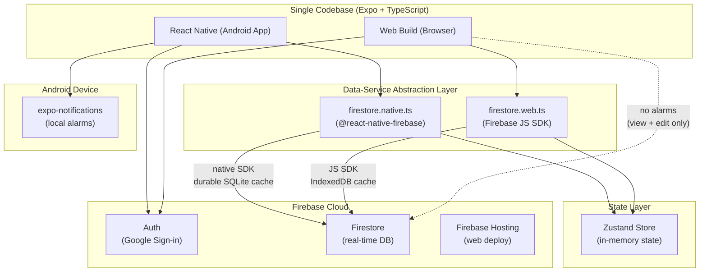

# Architecture & Technical Specifications

> **System Overview:** Single codebase cross-platform application (Expo / React Native + TypeScript) serving Android (primary mobile client) and Web (desktop browser view/edit).

---

## 1. System Architecture Diagram



---

## 2. Dual-SDK Strategy & Offline Persistence
- **Android App:** Uses `@react-native-firebase/firestore` backed by native SQLite/LevelDB storage. Guarantees durable offline writes that survive forced process termination and device reboot.
- **Web App:** Uses `firebase/firestore` (JS SDK) backed by browser IndexedDB.
- **Abstraction:** Split implementations (`firestore.native.ts` vs `firestore.web.ts`) expose identical TypeScript interfaces (`firestore.ts`), ensuring UI code and Zustand stores remain platform-agnostic.

---

## 3. Data Model & Timestamp Contract
- **Storage:** All timestamps (`plannedStart`, `plannedEnd`, `actualStart`, `actualEnd`, `createdAt`, `updatedAt`) are stored strictly in **UTC** as Firestore `Timestamp` objects.
- **Display & Queries:** Dates are formatted in **IST (Asia/Kolkata, UTC+5:30)**. Query indexing uses an explicit IST date string (`date: "YYYY-MM-DD"`) to eliminate date-rollover inconsistencies around midnight IST.
- **Immutability:** `actualStart` and `actualEnd` are write-once records set solely upon "Start now" and "Finish". They cannot be overwritten during planned schedule edits.

---

## 4. Notifications & Alarms Strategy
- **Android Alarms:** Scheduled using `delivery: 'alarmClock'` on Android `IMPORTANCE_HIGH` custom channels. Falls back gracefully to `bestEffort` if `SCHEDULE_EXACT_ALARM` is denied on Android 14+.
- **Reboot & Sync Limitations:** Acknowledges that Firestore listeners cannot execute when the app process is terminated. 
  - Alarms are scheduled within a 7-day rolling window.
  - Full foreground self-healing resync runs whenever `AppState` transitions to `active`.
  - Web client displays a warning banner when users modify a task due within 2 hours.

---

## 5. Security Rules
Every user has exclusive read and write permissions limited to their own subcollections under `users/{uid}/`:

```javascript
rules_version = '2';
service cloud.firestore {
  match /databases/{database}/documents {
    match /users/{uid}/{document=**} {
      allow read, write: if request.auth != null && request.auth.uid == uid;
    }
    match /{document=**} {
      allow read, write: if false;
    }
  }
}
```

---

## 6. Directory Structure
```
TimeManagementApp/
├── app/                              # Expo Router file-based routes
│   ├── _layout.tsx                   # Auth gate & theme provider
│   ├── (auth)/sign-in.tsx            # Google sign-in
│   ├── (tabs)/                       # Tab navigation (index, tasks, settings)
│   └── task/[id].tsx                 # Task create/view/edit
├── src/
│   ├── components/                   # UI components (TimelineView, TaskCard, etc.)
│   ├── stores/                       # Zustand state stores
│   ├── services/
│   │   ├── firebase/                 # Native/Web Firebase abstraction
│   │   ├── notifications/            # Alarm scheduling & permission logic
│   │   ├── backup/                   # JSON export & import
│   │   ├── routineGenerator.ts       # Template task instantiation
│   │   └── validation.ts             # Task mutation validation
│   ├── constants/                    # Categories, routine templates, timezone
│   ├── types/                        # TypeScript definitions
│   └── utils/                        # Date/time & IST converters
├── firestore.rules
├── firebase.json
├── app.json
└── eas.json
```

