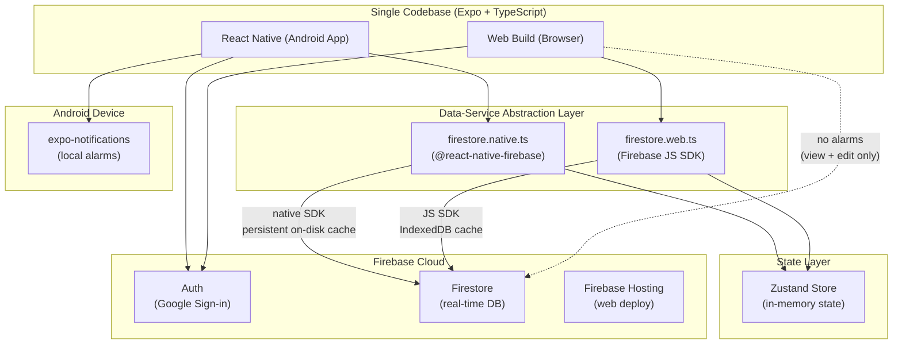

# Architecture & Technical Specifications

> **System Overview:** Single codebase cross-platform application (Expo / React Native + TypeScript) serving Android (primary mobile client) and Web (desktop browser view/edit).

---

## 1. System Architecture Diagram



---

## 2. Dual-SDK Strategy & Offline Persistence

### Android Native Persistence
- Uses `@react-native-firebase/firestore` (wrapping native Android Firebase SDK).
- Offline persistence is enabled by default by Google's native SDK. Writes are queued to native disk storage and synchronized to the cloud when connectivity resumes.
- **Accurate Durability Note:** While native disk caching is resilient across process terminations under normal conditions, aggressive OEM battery killers (e.g. MIUI/HyperOS, ColorOS) or database corruption could occasionally interrupt pending writes. Therefore, the application does not rely on local cache as an absolute guarantee: **manual JSON export/import remains the true independent backup mechanism**.

### Web Offline Persistence
- Uses `firebase/firestore` (JS modular SDK v10/v11+).
- Explicitly configured with `persistentLocalCache({ tabManager: persistentMultipleTabManager() })` backed by browser IndexedDB.
- **Multi-Tab Behavior:** `persistentMultipleTabManager()` coordinates synchronization across multiple open browser tabs so writes made in Tab A update Tab B without write collisions.
- **Web Privacy & Security Consideration:** Because IndexedDB persists locally in the browser profile, users on shared or public workstations must be warned to sign out or use private/incognito browsing to avoid leaving cached task data on disk.

### Data Abstraction Interface
Components and Zustand stores interact exclusively with a shared interface (`firestore.ts`). Metro bundler resolves `firestore.native.ts` for Android builds and `firestore.web.ts` for web builds.

---

## 3. Data Model & Timestamp Contract

### Storage & Display Rules
1. **UTC Storage:** All date-time fields (`plannedStart`, `plannedEnd`, `actualStart`, `actualEnd`, `createdAt`, `updatedAt`, `cancelledAt`) are stored strictly as UTC `Timestamp` objects.
2. **IST Display & Querying:** The `date` field is stored as an ISO date string (`"YYYY-MM-DD"`) evaluated in **IST (Asia/Kolkata, UTC+5:30)**. Queries like *"give me today's timetable"* query by `date == "YYYY-MM-DD"` to avoid timezone rollover discrepancies around midnight.
3. **Write-Once Actual Execution Times:**
   - `actualStart` is set when the user triggers "Start now".
   - `actualEnd` is set when the user triggers "Finish".
   - Neither field is overwritten when editing planned times, titles, categories, or notes.
4. **Reopening Completed Tasks:** If a task was marked `done` by mistake, a deliberate "Reopen" action resets `status` to `in_progress` while **preserving existing `actualStart` and `actualEnd` timestamps** for auditing.
5. **Deterministic Task IDs for Routine Generation:**
   - Routine instances use deterministic IDs formatted as: `${sourceTemplateId}_${date}_${blockIndex}` (e.g., `default_weekday_2026-11-08_0`).
   - If multiple devices (phone and web) trigger routine generation for the same upcoming days, they target identical document paths in Firestore, completely eliminating duplicate tasks.

### Complete TypeScript Schema

```typescript
import { Timestamp } from 'firebase/firestore';

export type TaskPriority = 'high' | 'medium' | 'low';

export type TaskStatus = 'pending' | 'in_progress' | 'done' | 'skipped' | 'cancelled';

export interface RecurrenceRule {
  type: 'daily' | 'weekdays' | 'weekly' | 'custom';
  daysOfWeek?: number[]; // 0 = Sun, 1 = Mon, ..., 6 = Sat
  endDate?: string;      // Optional "YYYY-MM-DD"
}

export interface Task {
  id: string;                           // Generated or deterministic: `${templateId}_${date}_${index}`
  title: string;                        // Required, 1-200 characters
  category: string;                     // Required (e.g. "Career", "Learning", "Health")
  priority: TaskPriority;               // Required: 'high' | 'medium' | 'low'
  date: string;                         // Required: "YYYY-MM-DD" in IST
  plannedStart: Timestamp;              // Required: UTC Timestamp
  plannedEnd: Timestamp;                // Required: UTC Timestamp, must be > plannedStart
  durationMin: number;                  // Required: 5 to 480 minutes
  actualStart: Timestamp | null;        // Write-once on start, nullable
  actualEnd: Timestamp | null;          // Write-once on finish, nullable
  status: TaskStatus;                   // Required: pending | in_progress | done | skipped | cancelled
  isFixed: boolean;                     // Flag for fixed commitments (Phase 3 protection)
  recurrenceRule: RecurrenceRule | null;// Recurrence definition or null
  parentRecurringTaskId: string | null; // Pointer to parent if generated from recurring task
  isFromTemplate: boolean;              // True if generated from routine template
  sourceTemplateId: string | null;      // Template ID used to generate this task
  reminderMinutesBefore: number | null; // e.g., 0, 5, 10, 30, or null
  notificationIds: string[];            // expo-notifications scheduled IDs
  notes: string;                        // Optional text notes
  links: string[];                      // Optional web URLs
  cancelledAt: Timestamp | null;        // UTC Timestamp when cancelled
  createdAt: Timestamp;                 // UTC Timestamp
  updatedAt: Timestamp;                 // UTC Timestamp
}

export interface RoutineBlock {
  blockIndex: number;                   // 0-indexed position in routine
  title: string;                        // e.g. "Morning Career Work"
  category: string;                     // e.g. "Career"
  priority: TaskPriority;
  startTime: string;                    // "HH:mm" 24h format in IST (e.g. "09:00")
  durationMin: number;                  // Minutes
  isFixed: boolean;                     // Protected flag
  reminderMinutesBefore: number | null;
}

export interface RoutineTemplate {
  id: string;                           // e.g. "default_weekday"
  name: string;                         // e.g. "Default Weekday Routine"
  blocks: RoutineBlock[];               // Ordered schedule blocks
  daysOfWeek: number[];                 // [1, 2, 3, 4, 5] for Mon-Fri
  isActive: boolean;                    // Active toggle
  createdAt: Timestamp;
  updatedAt: Timestamp;
}

export interface UserSettings {
  defaultReminderMinutesBefore: number; // Default: 5
  theme: 'light' | 'dark' | 'system';
  categories: string[];                 // User-editable category list
  wakeUpTime: string;                   // "08:00" in IST
  windDownTime: string;                 // "22:45" in IST
  batteryOptimizationDismissed: boolean;
  createdAt: Timestamp;
  updatedAt: Timestamp;
}
```

### Valid Status Transitions
```
[pending]     ──> [in_progress], [skipped], [cancelled]
[in_progress] ──> [done], [skipped], [cancelled]
[done]        ──> [in_progress] (deliberate Reopen action)
[skipped]     ──> [pending]
[cancelled]   ──> (terminal)
```

---

## 4. Notifications & Alarms Strategy

### Unified 7-Day Window
- **Task Generation & Notification Scheduling Window:** Exactly **7 days**. When the app opens, it ensures routine tasks and local notifications are scheduled for the upcoming 7-day rolling window.
- **Safety Net Daily Repeating Alarms:** Wake-up (`08:00` IST) and Wind-down (`22:45` IST) are scheduled as **repeating daily local alarms**. Even if the user does not open the app for several days, wake-up and sleep alarms will continue to fire.

### Exact Alarm vs Best-Effort Delivery
- **`alarmClock` Delivery:** Uses Android `AlarmManager.setAlarmClock()`. Wakes the CPU, bypasses system Doze mode and OEM battery-saving windows, and renders a persistent alarm clock icon in the Android status bar.
- **`bestEffort` Delivery:** Default delivery mode on Android when exact alarm permissions are absent. The OS batches notifications to preserve battery, causing delivery delays of 5–15 minutes.
- **Which Reminders Use Exact Delivery:**
  1. Task start alarms where `isFixed == true` (time-critical commitments).
  2. Daily Wake-up and Wind-down safety net alarms.
  3. Non-fixed tasks fallback to `bestEffort` if the user declines `SCHEDULE_EXACT_ALARM` permissions.

### Exact Alarm Verification Status
- Supported in modern `expo-notifications` (starting Expo SDK 58, PR `#49687`, utilizing `delivery: 'alarmClock'`).
- **Status:** **UNVERIFIED on our physical device**. We will experimentally validate this during **Step 3.5 (Early Real-Device Alarm Test)**. If `expo-notifications` does not wake the device reliably during testing, **Notifee** will be evaluated as the alternative native alarm engine.

### Android Permission Flow
1. **Android 13+ (`POST_NOTIFICATIONS`):** Requested after creating an `IMPORTANCE_HIGH` notification channel.
2. **Android 14+ (`SCHEDULE_EXACT_ALARM`):** Denied by default on fresh installs. The app checks `getExactAlarmPermissionsAsync()` and guides the user via deep-link to **Settings → Alarms & reminders**.
3. **Foreground Self-Healing Resync:** Whenever the app enters foreground (`AppState === 'active'`), it reconciles server tasks with active device notification IDs, dropping obsolete alarms and rescheduling updated ones.

---

## 5. Backup & Recovery Protocol (JSON Export/Import)
1. **Export:** Generates a full snapshot (`tasks`, `routineTemplates`, `settings`) as a single JSON file downloaded to device storage.
2. **Import ("Replace All"):**
   - **Safety First:** The app automatically generates and downloads an in-memory safety backup of the existing state before replacing data.
   - **Notification Cleanup:** After import, all old scheduled alarms are cancelled, and fresh notifications are scheduled for the imported 7-day window.

---

## 6. Firestore Security Rules

Rules enforce server-side validation on field types, ownership, time constraints, and duration limits:

```javascript
rules_version = '2';
service cloud.firestore {
  match /databases/{database}/documents {

    // Helper functions
    function isAuthenticated() {
      return request.auth != null;
    }

    function isOwner(uid) {
      return isAuthenticated() && request.auth.uid == uid;
    }

    function isValidTask(data) {
      return data.title is string && data.title.size() > 0 && data.title.size() <= 200
        && data.category is string && data.category.size() > 0
        && data.priority in ['high', 'medium', 'low']
        && data.status in ['pending', 'in_progress', 'done', 'skipped', 'cancelled']
        && data.date is string && data.date.matches('^\\d{4}-\\d{2}-\\d{2}$')
        && data.plannedStart is timestamp
        && data.plannedEnd is timestamp
        && data.plannedEnd > data.plannedStart
        && data.durationMin is int && data.durationMin >= 5 && data.durationMin <= 480
        && (data.actualStart == null || data.actualStart is timestamp)
        && (data.actualEnd == null || data.actualEnd is timestamp)
        && data.isFixed is bool;
    }

    // User data subcollections
    match /users/{uid} {
      allow read, write: if isOwner(uid);

      match /tasks/{taskId} {
        allow read: if isOwner(uid);
        allow create, update: if isOwner(uid) && isValidTask(request.resource.data);
        allow delete: if isOwner(uid);
      }

      match /routineTemplates/{templateId} {
        allow read, write: if isOwner(uid);
      }

      match /settings/{settingId} {
        allow read, write: if isOwner(uid);
      }
    }

    // Default deny all other paths
    match /{document=**} {
      allow read, write: if false;
    }
  }
}
```
