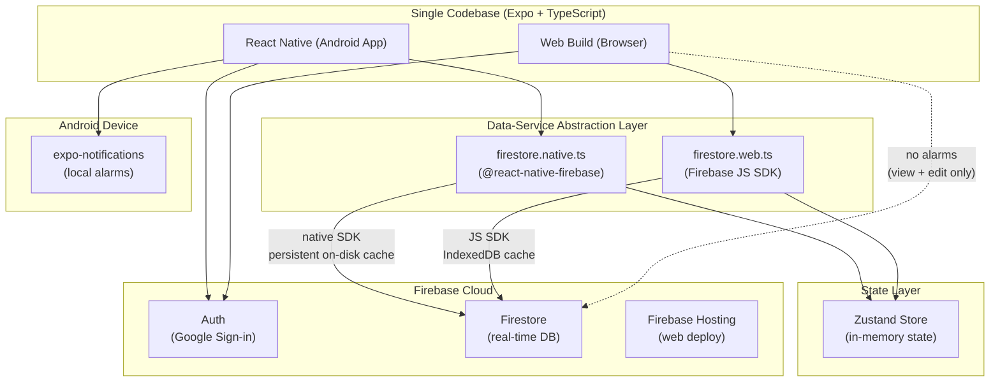

# Architecture & Technical Specifications

> **System Overview:** Single codebase cross-platform application (Expo / React Native + TypeScript) serving Android (primary mobile client) and Web (desktop browser view/edit).

---

## 1. System Architecture Diagram



---

## 2. Dual-SDK Strategy & Offline Persistence

### Android Native Persistence
- Uses `@react-native-firebase/firestore` (wrapping native Android Firebase SDK).
- Offline persistence is enabled by default by Google's native SDK. Writes are queued to native disk storage and synchronized to the cloud when connectivity resumes.
- **Accurate Durability Note:** While native disk caching is resilient across process terminations under normal conditions, aggressive OEM battery killers (e.g. MIUI/HyperOS, ColorOS) or database corruption could occasionally interrupt pending writes. Therefore, the application does not rely on local cache as an absolute guarantee: **manual JSON export/import remains the true independent backup mechanism**.

### Web Offline Persistence
- Uses `firebase/firestore` (JS modular SDK v10/v11+).
- Explicitly configured with `persistentLocalCache({ tabManager: persistentMultipleTabManager() })` backed by browser IndexedDB.
- **Multi-Tab Behavior:** `persistentMultipleTabManager()` coordinates synchronization across multiple open browser tabs so writes made in Tab A update Tab B without write collisions.
- **Web Privacy & Security Consideration:** Because IndexedDB persists locally in the browser profile, users on shared or public workstations must be warned to sign out or use private/incognito browsing to avoid leaving cached task data on disk.

### Data Abstraction Interface & Serialisable Timestamp Type
To ensure complete type compatibility across both SDKs without build errors:
- **Serialisable Domain Timestamp:** The shared types do NOT import `Timestamp` directly from `firebase/firestore` or `@react-native-firebase/firestore`. Instead, domain models use a pure, JSON-serialisable interface `AppTimestamp` containing only `{ seconds: number; nanoseconds: number }`. Date/epoch/ISO conversions are handled via pure utility functions (`dateToAppTimestamp`, `appTimestampToDate`, `appTimestampToMillis`, `appTimestampToISOString`).
- Platform adapters (`firestore.native.ts` and `firestore.web.ts`) handle bidirectionally mapping their respective native SDK `Timestamp` objects to and from the domain `AppTimestamp`.

---

## 3. Data Model & Timestamp Contract

### Storage & Display Rules
1. **UTC Storage:** All date-time fields (`plannedStart`, `plannedEnd`, `actualStart`, `actualEnd`, `createdAt`, `updatedAt`, `cancelledAt`) are stored strictly as UTC `AppTimestamp` objects.
2. **IST Display & Querying:** The `date` field is stored as an ISO date string (`"YYYY-MM-DD"`) evaluated in **IST (Asia/Kolkata, UTC+5:30)**. Queries like *"give me today's timetable"* query by `date == "YYYY-MM-DD"` to avoid timezone rollover discrepancies around midnight.
3. **Write-Once Actual Execution Times & Reopen History:**
   - `actualStart` is set when the user triggers "Start now".
   - `actualEnd` is set when the user triggers "Finish".
   - Neither field is overwritten when editing planned times, titles, categories, or notes.
   - **Reopening Completed Tasks:** If a task was marked `done` by mistake, a deliberate "Reopen" action:
     - Moves current `{ actualStart, actualEnd, reopenedAt }` into an audit array: `actualHistory: ActualTimeEntry[]` (using `actualEnd` as completion time).
     - Resets `actualStart` and `actualEnd` to `null`.
     - Changes `status` back to `in_progress`.
     - This preserves past time records while enabling a fresh Start/Finish sequence.
4. **Idempotent Routine Generation (Create-If-Not-Exists):**
   - Deterministic task IDs format: `${sourceTemplateId}_${date}_${blockId}` (using stable string `blockId`, e.g. `career_morning`, rather than array index).
   - Generated using **create-if-not-exists transactions** (`transaction.get()` then create only if missing).
   - **Online-Only Generation Rule:** Because Firestore transactions require server connectivity, routine generation runs only when the device is online. If offline, generation skips silently and retries upon the next app open or network reconnect. The UI is **never blocked** by routine generation.
   - If a document already exists at that ID (whether pending, in progress, completed, or custom-edited), it is **never overwritten**.
   - Multiple devices running generation simultaneously will cleanly no-op on existing records.

### Complete TypeScript Domain Schema

```typescript
export type TaskPriority = 'high' | 'medium' | 'low';

export type TaskStatus = 'pending' | 'in_progress' | 'done' | 'skipped' | 'cancelled';

/** Platform-independent, JSON-serialisable Timestamp representation compatible with both Web and Native Firebase SDKs */
export interface AppTimestamp {
  seconds: number;
  nanoseconds: number;
}

export interface ActualTimeEntry {
  actualStart: AppTimestamp;
  actualEnd: AppTimestamp;
  reopenedAt: AppTimestamp;
}

export interface RecurrenceRule {
  type: 'daily' | 'weekdays' | 'weekly' | 'custom';
  daysOfWeek?: number[]; // 0 = Sun, 1 = Mon, ..., 6 = Sat
  endDate?: string;      // Optional "YYYY-MM-DD"
}

export interface Task {
  id: string;                           // Deterministic: `${templateId}_${date}_${blockId}`
  title: string;                        // Required, 1-200 characters
  category: string;                     // Required (e.g. "Career", "Learning", "Health")
  priority: TaskPriority;               // Required: 'high' | 'medium' | 'low'
  date: string;                         // Required: "YYYY-MM-DD" in IST
  plannedStart: AppTimestamp;           // Required: UTC Timestamp
  plannedEnd: AppTimestamp;             // Required: UTC Timestamp, must be > plannedStart
  durationMin: number;                  // Required: 5 to 480 minutes
  actualStart: AppTimestamp | null;     // Write-once on start, nullable
  actualEnd: AppTimestamp | null;       // Write-once on finish, nullable
  actualHistory: ActualTimeEntry[];     // Archived execution runs from reopened sessions
  status: TaskStatus;                   // Required: pending | in_progress | done | skipped | cancelled
  isFixed: boolean;                     // Flag for fixed commitments (Phase 3 protection)
  recurrenceRule: RecurrenceRule | null;// Recurrence definition or null
  parentRecurringTaskId: string | null; // Pointer to parent if generated from recurring task
  isFromTemplate: boolean;              // True if generated from routine template
  sourceTemplateId: string | null;      // Template ID used to generate this task
  reminderMinutesBefore: number | null; // e.g., 0, 5, 10, 30, or null
  notificationIds: string[];            // expo-notifications scheduled IDs
  notes: string;                        // Optional text notes
  links: string[];                      // Optional web URLs
  cancelledAt: AppTimestamp | null;     // UTC Timestamp when cancelled
  createdAt: AppTimestamp;              // UTC Timestamp
  updatedAt: AppTimestamp;              // UTC Timestamp
}

export interface RoutineBlock {
  blockId: string;                      // Stable identifier (e.g. "career_am", "exercise_pm")
  title: string;                        // e.g. "Morning Career Work"
  category: string;                     // e.g. "Career"
  priority: TaskPriority;
  startTime: string;                    // "HH:mm" 24h format in IST (e.g. "09:00")
  durationMin: number;                  // Minutes
  isFixed: boolean;                     // Protected flag
  reminderMinutesBefore: number | null;
}

export interface RoutineTemplate {
  id: string;                           // e.g. "default_weekday"
  name: string;                         // e.g. "Default Weekday Routine"
  blocks: RoutineBlock[];               // Ordered schedule blocks with stable blockIds
  daysOfWeek: number[];                 // [1, 2, 3, 4, 5] for Mon-Fri
  isActive: boolean;                    // Active toggle
  createdAt: AppTimestamp;
  updatedAt: AppTimestamp;
}

export interface UserSettings {
  defaultReminderMinutesBefore: number; // Default: 5
  theme: 'light' | 'dark' | 'system';
  categories: string[];                 // User-editable category list
  wakeUpTime: string;                   // "08:00" in IST
  windDownTime: string;                 // "22:45" in IST
  batteryOptimizationDismissed: boolean;
  createdAt: AppTimestamp;
  updatedAt: AppTimestamp;
}
```

### Valid Status Transitions
```
[pending]     ──> [in_progress], [skipped], [cancelled]
[in_progress] ──> [done], [skipped], [cancelled]
[done]        ──> [in_progress] (deliberate Reopen: archives to actualHistory)
[skipped]     ──> [pending]
[cancelled]   ──> (terminal)
```

---

## 4. Notifications & Alarms Strategy

### Unified 7-Day Window
- **Task Generation & Notification Scheduling Window:** Exactly **7 days**. When the app opens, it ensures routine tasks and local notifications are scheduled for the upcoming 7-day rolling window.
- **Safety Net Daily Repeating Alarms:** Wake-up (`08:00` IST) and Wind-down (`22:45` IST) are scheduled as **repeating daily local alarms**. Even if the user does not open the app for several days, wake-up and sleep alarms will continue to fire.

### Exact Alarm vs Best-Effort Delivery
- **`alarmClock` Delivery:** Uses Android `AlarmManager.setAlarmClock()`. Intended to wake the device CPU for time-critical alarms.
  - **Reference:** Introduced in `expo-notifications` (Expo SDK 58, PR `#49687`: [Expo Notifications Changelog](https://github.com/expo/expo/blob/main/packages/expo-notifications/CHANGELOG.md)).
  - **Verification Status:** **UNVERIFIED on target physical hardware**. Will be experimentally verified in **Step 3.5**. If unverified or failing, **Notifee** will be evaluated as a native alternative.
- **`bestEffort` Delivery:** Standard Android notification delivery using inexact alarms (`AlarmManager.set()` or `setWindow()`). The operating system may batch or delay notifications by 5–15 minutes (or longer during deep Doze mode) to conserve battery. Used for non-fixed task reminders and as the graceful fallback whenever exact alarm permissions are absent or denied.
- **Which Reminders Use Exact Delivery:**
  1. Task start alarms where `isFixed == true` (time-critical commitments).
  2. Daily Wake-up and Wind-down safety net alarms.
  3. Non-fixed tasks fallback to `bestEffort` if `SCHEDULE_EXACT_ALARM` permissions are not granted.

### Android Permission Flow & Revocation Handling
1. **Android 13+ (`POST_NOTIFICATIONS`):** Requested after creating an `IMPORTANCE_HIGH` notification channel.
2. **Android 14+ (`SCHEDULE_EXACT_ALARM`):** Denied by default on fresh installs.
3. **Handling Permission Revocation:** If a user revokes `SCHEDULE_EXACT_ALARM` in system settings, Android automatically cancels all registered exact alarms. Therefore, our **foreground resync** runs on every app launch (`AppState === 'active'`), verifies current alarm permission state, and re-registers the entire 7-day window accordingly.

---

## 5. Backup & Recovery Protocol (JSON Export/Import)
1. **Export:** Generates a full snapshot (`tasks`, `routineTemplates`, `settings`) as a single JSON file.
2. **Import ("Replace All") with Mandatory Pre-Backup:**
   - **Verification Requirement:** The application **will not proceed** with a "Replace All" wipe until it has verified that the existing state has been successfully serialized and saved to device storage:
     - **Web:** Verified by generating a download blob and triggering standard browser file-save completion.
     - **Android:** Verified by writing the backup file via `expo-file-system` / `expo-sharing` to the user's Downloads/Documents folder and confirming non-zero byte size on disk.
   - If the pre-backup creation fails or is cancelled, the import aborts immediately with an error dialog, leaving existing data untouched.
   - Following verified replacement, all old alarms are cleared and fresh alarms are scheduled for the 7-day window.

---

## 6. Firestore Security Rules

Hardened security rules restrict schema keys, validate ownership, enforce duration boundaries, ensure write-once actual times on updates, and validate routine templates and settings structures:

```javascript
rules_version = '2';
service cloud.firestore {
  match /databases/{database}/documents {

    function isAuthenticated() {
      return request.auth != null;
    }

    function isOwner(uid) {
      return isAuthenticated() && request.auth.uid == uid;
    }

    // Task Document Validation
    function isValidTaskData(data) {
      let allowedKeys = [
        'id', 'title', 'category', 'priority', 'date',
        'plannedStart', 'plannedEnd', 'durationMin',
        'actualStart', 'actualEnd', 'actualHistory',
        'status', 'isFixed', 'recurrenceRule',
        'parentRecurringTaskId', 'isFromTemplate', 'sourceTemplateId',
        'reminderMinutesBefore', 'notificationIds', 'notes', 'links',
        'cancelledAt', 'createdAt', 'updatedAt'
      ];

      return data.keys().hasOnly(allowedKeys)
        && data.title is string && data.title.size() > 0 && data.title.size() <= 200
        && data.category is string && data.category.size() > 0
        && data.priority in ['high', 'medium', 'low']
        && data.status in ['pending', 'in_progress', 'done', 'skipped', 'cancelled']
        && data.date is string && data.date.matches('^\\d{4}-\\d{2}-\\d{2}$')
        && data.plannedStart is timestamp
        && data.plannedEnd is timestamp
        && data.plannedEnd > data.plannedStart
        && data.durationMin is int && data.durationMin >= 5 && data.durationMin <= 480
        && (data.actualStart == null || data.actualStart is timestamp)
        && (data.actualEnd == null || data.actualEnd is timestamp)
        && data.actualHistory is list
        && data.isFixed is bool
        && (data.reminderMinutesBefore == null || (data.reminderMinutesBefore is int && data.reminderMinutesBefore >= 0))
        && data.notificationIds is list
        && data.notes is string
        && data.links is list
        && (data.cancelledAt == null || data.cancelledAt is timestamp)
        && data.createdAt is timestamp
        && data.updatedAt is timestamp;
    }

    // Enforce Valid Status Transitions
    function isValidStatusTransition(oldStatus, newStatus) {
      return (oldStatus == newStatus)
        || (oldStatus == 'pending' && newStatus in ['in_progress', 'skipped', 'cancelled'])
        || (oldStatus == 'in_progress' && newStatus in ['done', 'skipped', 'cancelled'])
        || (oldStatus == 'done' && newStatus == 'in_progress') // Reopen
        || (oldStatus == 'skipped' && newStatus == 'pending');
    }

    // Write-Once Enforcement: Prevents overwriting already recorded actual times during standard updates
    function isActualTimesProtected(existing, incoming) {
      let preservesStart = (existing.actualStart == null) || (incoming.actualStart == existing.actualStart) || (incoming.status == 'in_progress' && existing.status == 'done');
      let preservesEnd = (existing.actualEnd == null) || (incoming.actualEnd == existing.actualEnd) || (incoming.status == 'in_progress' && existing.status == 'done');
      return preservesStart && preservesEnd;
    }

    // Routine Template Document Validation
    function isValidRoutineTemplate(data) {
      let allowedKeys = ['id', 'name', 'blocks', 'daysOfWeek', 'isActive', 'createdAt', 'updatedAt'];
      return data.keys().hasOnly(allowedKeys)
        && data.name is string && data.name.size() > 0 && data.name.size() <= 100
        && data.blocks is list
        && data.daysOfWeek is list
        && data.isActive is bool
        && data.createdAt is timestamp
        && data.updatedAt is timestamp;
    }

    // Settings Document Validation
    function isValidSettings(data) {
      let allowedKeys = ['defaultReminderMinutesBefore', 'theme', 'categories', 'wakeUpTime', 'windDownTime', 'batteryOptimizationDismissed', 'createdAt', 'updatedAt'];
      return data.keys().hasOnly(allowedKeys)
        && data.defaultReminderMinutesBefore is int && data.defaultReminderMinutesBefore >= 0
        && data.theme in ['light', 'dark', 'system']
        && data.categories is list && data.categories.size() > 0
        && data.wakeUpTime is string && data.wakeUpTime.matches('^\\d{2}:\\d{2}$')
        && data.windDownTime is string && data.windDownTime.matches('^\\d{2}:\\d{2}$')
        && data.batteryOptimizationDismissed is bool
        && data.createdAt is timestamp
        && data.updatedAt is timestamp;
    }

    // User Subcollections
    match /users/{uid} {
      allow read, write: if isOwner(uid);

      match /tasks/{taskId} {
        allow read: if isOwner(uid);
        allow create: if isOwner(uid) && isValidTaskData(request.resource.data);
        allow update: if isOwner(uid)
          && isValidTaskData(request.resource.data)
          && isValidStatusTransition(resource.data.status, request.resource.data.status)
          && isActualTimesProtected(resource.data, request.resource.data);
        allow delete: if isOwner(uid);
      }

      match /routineTemplates/{templateId} {
        allow read: if isOwner(uid);
        allow create, update: if isOwner(uid) && isValidRoutineTemplate(request.resource.data);
        allow delete: if isOwner(uid);
      }

      match /settings/{settingId} {
        allow read: if isOwner(uid);
        allow create, update: if isOwner(uid) && isValidSettings(request.resource.data);
        allow delete: if isOwner(uid);
      }
    }

    match /{document=**} {
      allow read, write: if false;
    }
  }
}
```
