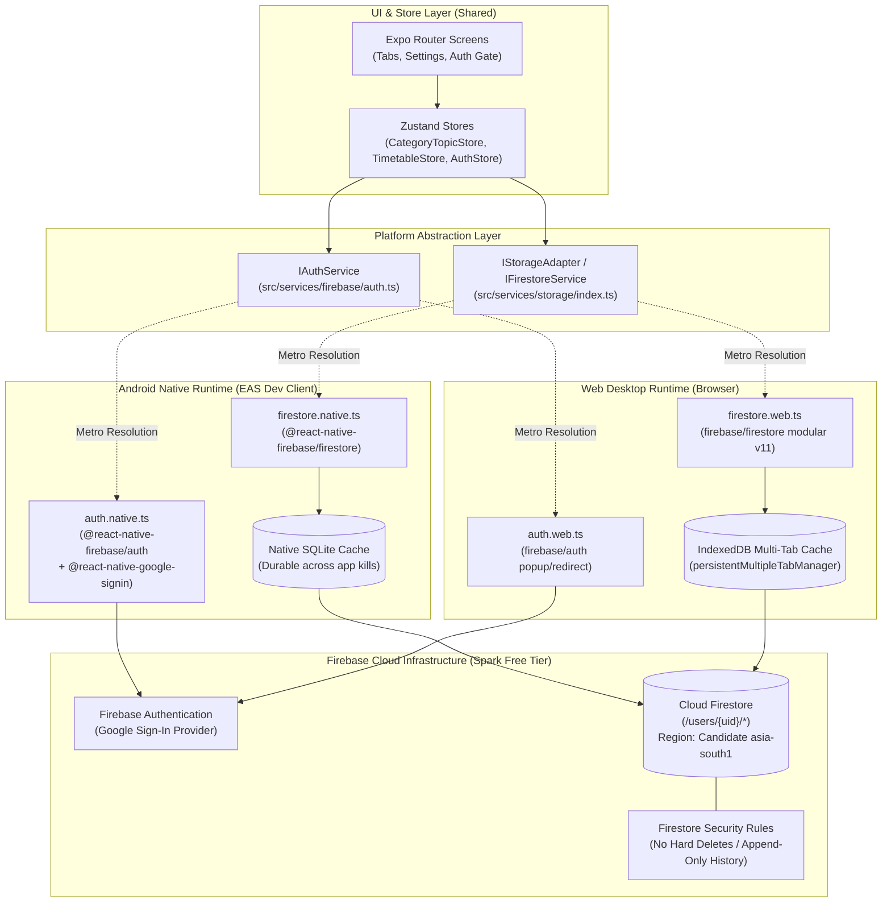
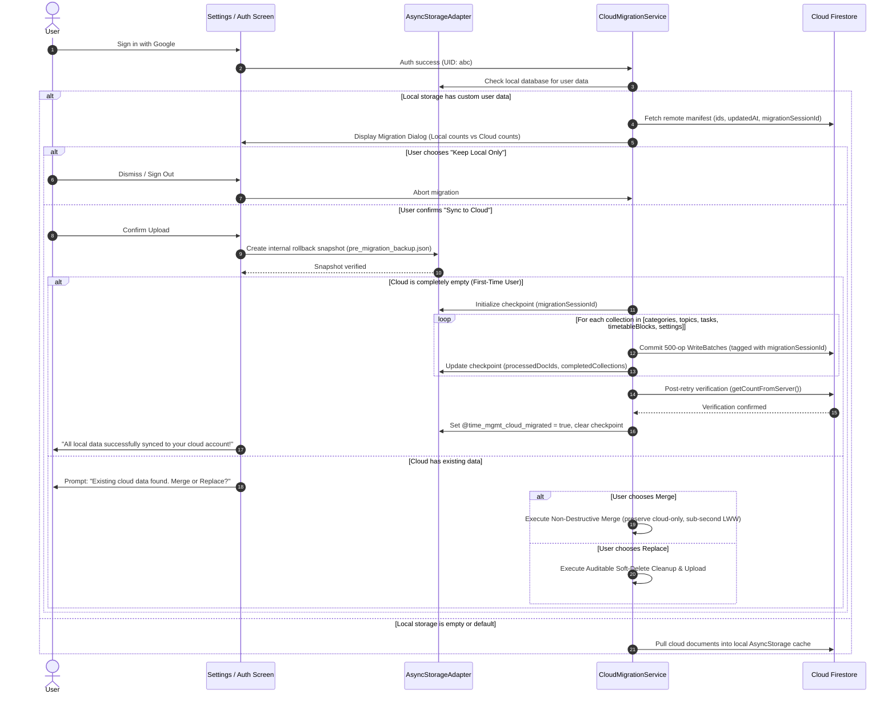
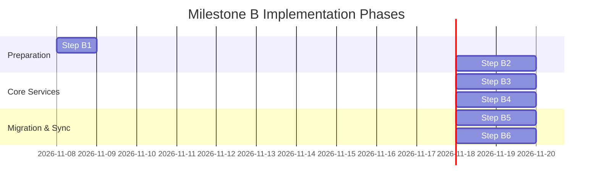

# Milestone B Implementation Plan: Firebase, Google Auth & Cloud Sync

> [!IMPORTANT]
> **Status:** PROPOSED (Revision 2 with Critical Security, Migration & Concurrency Feedback) — Awaiting Technical Review by ChatGPT and Approval by User.  
> **Strict Rules:**
> 1. No application code changes, package installations, or Firebase cloud resource creations will take place until this plan is formally approved.
> 2. Step B0 deferred validation issue (REV-018) remains documented as a KNOWN ISSUE.
> 3. Step B0 is not marked approved and will not be merged into `main` until separately resolved.
> 4. Milestone B implementation remains strictly blocked until Step B0 is approved.

---

## 1. Executive Summary & Architecture Overview

Milestone B transitions the Time Management application from the hardened Milestone A/B0 local storage (`AsyncStorageAdapter`) to a **cross-platform, real-time synchronized cloud architecture** powered by Firebase, while preserving 100% of existing local features, data integrity, and offline capability.

### Architectural Tenets
1. **Dual-SDK Platform Abstraction:**
   - **Android (Native):** Uses `@react-native-firebase/app`, `@react-native-firebase/auth`, and `@react-native-firebase/firestore`. Backed by native Android SQLite/LevelDB for durable offline storage that survives app termination and device reboots.
   - **Web (Browser):** Uses modular `firebase/app`, `firebase/auth`, and `firebase/firestore` (JS SDK v11.4.0) configured with `persistentMultipleTabManager()` for robust IndexedDB browser tab persistence.
   - **Unified Service Interface:** The application layer (Zustand stores and UI screens) interacts strictly with a platform-agnostic service interface (`firestore.ts` and `auth.ts`), resolved automatically by Metro via `.native.ts` and `.web.ts` extensions.
2. **Strict User Isolation & Soft-Delete Tombstones:**
   - All user data is partitioned under `/users/{uid}/...` subcollections.
   - Direct client hard deletes (`deleteDoc()`) are permanently blocked by Security Rules. All deletions use soft-delete tombstones (`isDeleted: true`, `deletedAt: timestamp`).
   - Server-side Firestore Security Rules validate schema, types, ownership, duration bounds, foreign keys against active non-deleted entities, and enforce append-only `actualHistory` and write-once execution times.
3. **Resumable Migration with Concurrency & Origin Tracking:**
   - First-time sign-in incorporates an explicit, opt-in migration protocol with record counts preview, internal rollback snapshot, deterministic document IDs, and local checkpointing (`@time_mgmt_migration_checkpoint`).
   - Tracks document origin via `migrationSessionId` to distinguish current-session uploads, pre-existing cloud data, and remote concurrent modifications.
   - Local data in `AsyncStorage` is never deleted.
4. **Strict Cost & Resource Discipline:**
   - Operates entirely within the Firebase Spark (Free) plan ($0/mo) and Expo EAS Free Tier (15 cloud builds/month).
   - Queries are bounded to rolling windows (e.g. 7-day timetable window) with pagination to eliminate unbounded full-collection scans.
   - Cloud Firestore region will be explicitly confirmed by the user prior to database creation (`asia-south1` Mumbai recommended candidate).

---

## 2. High-Level Architecture Diagram



---

## 3. Data Architecture & Firestore Schema

### Collection Hierarchy
All data belongs strictly to individual authenticated users. No global multi-tenant user collections exist:

```text
/users/{uid}                                (User root document: profile, schemaVersion, timestamps)
    ├── settings/
    │   └── userSettings                    (Preferences doc: theme, timeFormat, defaultBlockDurationMin, schemaVersion)
    ├── categories/
    │   └── {categoryId}                    (Category docs: name, priority, sortOrder, color, isDeleted, deletedAt, timestamps)
    ├── topics/
    │   └── {topicId}                       (Topic docs: categoryId, name, priority, sortOrder, color, isDeleted, deletedAt, timestamps)
    ├── tasks/
    │   └── {taskId}                        (Task docs: topicId, title, description, priority, isCompleted, isDeleted, deletedAt, timestamps)
    └── timetableBlocks/
        └── {blockId}                       (TimetableBlock docs: categoryId, title, date, startTime, durationMin, isFixed, notes, status, actualStart, actualEnd, actualHistory, isDeleted, deletedAt, timestamps)
```

### Entity Schema Mapping & Domain Precision
- **Bidirectional Timestamp Conversion:** Milestone A domain timestamps use `AppTimestamp` (`{ seconds: number; nanoseconds: number }`). Firestore `Timestamp` objects are converted bidirectionally with full sub-second precision retained.
- **Tombstone Fields on All Entity Collections:** Every collection schema formally includes:
  - `isDeleted: boolean` (default: `false`)
  - `deletedAt: Timestamp | null` (set when `isDeleted == true`)
- **Forward-Compatible TimetableBlock Execution Fields:**
  - `status`: `'planned' | 'in_progress' | 'completed' | 'cancelled'` (default on creation: `'planned'`)
  - `actualStart`: `Timestamp | null` (write-once when block enters `in_progress`)
  - `actualEnd`: `Timestamp | null` (write-once when block enters `completed`)
  - `actualHistory`: `Array<ActualHistoryEntry>` (strictly append-only log of execution intervals)
    ```typescript
    interface ActualHistoryEntry {
      id: string;               // UUID string (1-64 chars)
      startedAt: AppTimestamp;  // Valid timestamp
      endedAt: AppTimestamp;    // Valid timestamp >= startedAt
      durationMin: number;      // Integer >= 1 and <= 1440
      notes?: string;           // Optional string <= 1000 chars
    }
    ```

---

## 4. Server-Side Firestore Security Rules Specification

The security rules enforce:
1. **Zero Hard Deletes:** Client hard deletes (`delete`) are blocked unconditionally (`allow delete: if false;`).
2. **Creation Constraints:** Blocks cannot be created with pre-populated execution timestamps (`actualStart`, `actualEnd`) or history.
3. **Append-Only History:** Existing entries in `actualHistory` cannot be mutated or deleted; new entries must be appended and adhere to schema.
4. **Active Foreign Keys:** References to categories or topics verify that the target document exists **AND** has `isDeleted == false`.
5. **Strict Types & Ranges:** Rigorous regex for ISO dates, 24h times, hex colors, and duration constraints.

```javascript
rules_version = '2';
service cloud.firestore {
  match /databases/{database}/documents {
    
    // --- Helper Functions ---
    function isAuthenticated() {
      return request.auth != null;
    }
    
    function isOwner(uid) {
      return isAuthenticated() && request.auth.uid == uid;
    }
    
    function isValidTimestamp(ts) {
      return ts is timestamp;
    }
    
    function isValidPriority(p) {
      return p in ['high', 'medium', 'low'];
    }

    function isValidBlockStatus(s) {
      return s in ['planned', 'in_progress', 'completed', 'cancelled'];
    }

    // Foreign-key helper: target document must exist AND NOT be soft-deleted
    function isValidActiveCategory(uid, catId) {
      let path = /databases/$(database)/documents/users/$(uid)/categories/$(catId);
      return exists(path) && get(path).data.get('isDeleted', false) == false;
    }

    function isValidActiveTopic(uid, topId) {
      let path = /databases/$(database)/documents/users/$(uid)/topics/$(topId);
      return exists(path) && get(path).data.get('isDeleted', false) == false;
    }

    // Helper: Validates individual actualHistory entry structure
    function isValidHistoryEntry(entry) {
      return entry.keys().hasAll(['id', 'startedAt', 'endedAt', 'durationMin'])
        && entry.keys().hasOnly(['id', 'startedAt', 'endedAt', 'durationMin', 'notes'])
        && entry.id is string && entry.id.size() > 0 && entry.id.size() <= 64
        && isValidTimestamp(entry.startedAt)
        && isValidTimestamp(entry.endedAt)
        && entry.endedAt >= entry.startedAt
        && entry.durationMin is number && entry.durationMin >= 1 && entry.durationMin <= 1440
        && (!('notes' in entry) || (entry.notes is string && entry.notes.size() <= 1000));
    }

    // Helper: Enforces append-only semantics on actualHistory
    function isAppendOnlyHistory(oldHist, newHist) {
      return (oldHist == null || oldHist.size() == 0)
        ? (newHist is list)
        : (newHist is list 
           && newHist.size() >= oldHist.size() 
           && newHist.hasAll(oldHist));
    }

    // Default Deny All
    match /{document=**} {
      allow read, write: if false;
    }

    // User Root Document
    match /users/{uid} {
      allow read: if isOwner(uid);
      allow create: if isOwner(uid)
        && request.resource.data.keys().hasAll(['uid', 'schemaVersion', 'createdAt', 'updatedAt'])
        && request.resource.data.keys().hasOnly(['uid', 'email', 'displayName', 'photoURL', 'schemaVersion', 'createdAt', 'updatedAt'])
        && request.resource.data.uid == uid
        && request.resource.data.schemaVersion is number && request.resource.data.schemaVersion >= 2
        && isValidTimestamp(request.resource.data.createdAt)
        && isValidTimestamp(request.resource.data.updatedAt);
      allow update: if isOwner(uid)
        && request.resource.data.keys().hasAll(['uid', 'schemaVersion', 'createdAt', 'updatedAt'])
        && request.resource.data.keys().hasOnly(['uid', 'email', 'displayName', 'photoURL', 'schemaVersion', 'createdAt', 'updatedAt'])
        && request.resource.data.uid == resource.data.uid
        && request.resource.data.createdAt == resource.data.createdAt
        && request.resource.data.schemaVersion is number && request.resource.data.schemaVersion >= resource.data.schemaVersion
        && isValidTimestamp(request.resource.data.updatedAt)
        && request.resource.data.updatedAt >= resource.data.updatedAt;
      allow delete: if false; // Deny hard deletes

      // User Settings Subcollection
      match /settings/userSettings {
        allow read: if isOwner(uid);
        allow create, update: if isOwner(uid)
          && request.resource.data.keys().hasAll(['theme', 'timeFormat', 'defaultBlockDurationMin', 'schemaVersion', 'updatedAt'])
          && request.resource.data.keys().hasOnly(['theme', 'timeFormat', 'defaultBlockDurationMin', 'schemaVersion', 'updatedAt'])
          && request.resource.data.theme in ['system', 'light', 'dark']
          && request.resource.data.timeFormat in ['12h', '24h']
          && request.resource.data.defaultBlockDurationMin is number 
          && request.resource.data.defaultBlockDurationMin >= 5 && request.resource.data.defaultBlockDurationMin <= 240
          && request.resource.data.schemaVersion is number && request.resource.data.schemaVersion >= 2
          && isValidTimestamp(request.resource.data.updatedAt);
        allow delete: if false; // Deny hard deletes
      }
      
      // Categories Subcollection
      match /categories/{categoryId} {
        allow read: if isOwner(uid);
        allow create: if isOwner(uid)
          && request.resource.data.id == categoryId
          && request.resource.data.keys().hasAll(['id', 'name', 'priority', 'sortOrder', 'color', 'createdAt', 'updatedAt'])
          && request.resource.data.keys().hasOnly(['id', 'name', 'priority', 'sortOrder', 'color', 'isDeleted', 'deletedAt', 'migrationSessionId', 'createdAt', 'updatedAt'])
          && request.resource.data.id is string && request.resource.data.id.size() > 0 && request.resource.data.id.size() <= 64
          && request.resource.data.name is string && request.resource.data.name.size() > 0 && request.resource.data.name.size() <= 100
          && isValidPriority(request.resource.data.priority)
          && request.resource.data.sortOrder is number && request.resource.data.sortOrder >= 0
          && request.resource.data.color.matches('^#[0-9A-Fa-f]{6}$')
          && (!('isDeleted' in request.resource.data) || request.resource.data.isDeleted == false)
          && (!('deletedAt' in request.resource.data) || request.resource.data.deletedAt == null)
          && isValidTimestamp(request.resource.data.createdAt)
          && isValidTimestamp(request.resource.data.updatedAt);
        allow update: if isOwner(uid)
          && request.resource.data.id == resource.data.id
          && request.resource.data.createdAt == resource.data.createdAt
          && request.resource.data.keys().hasAll(['id', 'name', 'priority', 'sortOrder', 'color', 'createdAt', 'updatedAt'])
          && request.resource.data.keys().hasOnly(['id', 'name', 'priority', 'sortOrder', 'color', 'isDeleted', 'deletedAt', 'migrationSessionId', 'createdAt', 'updatedAt'])
          && request.resource.data.name is string && request.resource.data.name.size() > 0 && request.resource.data.name.size() <= 100
          && isValidPriority(request.resource.data.priority)
          && request.resource.data.sortOrder is number && request.resource.data.sortOrder >= 0
          && request.resource.data.color.matches('^#[0-9A-Fa-f]{6}$')
          && (!('isDeleted' in request.resource.data) || request.resource.data.isDeleted is bool)
          && (request.resource.data.get('isDeleted', false) == false || isValidTimestamp(request.resource.data.deletedAt))
          && isValidTimestamp(request.resource.data.updatedAt)
          && request.resource.data.updatedAt >= resource.data.updatedAt;
        allow delete: if false; // Deny hard deletes
      }
      
      // Topics Subcollection
      match /topics/{topicId} {
        allow read: if isOwner(uid);
        allow create: if isOwner(uid)
          && request.resource.data.id == topicId
          && request.resource.data.keys().hasAll(['id', 'categoryId', 'name', 'priority', 'sortOrder', 'color', 'createdAt', 'updatedAt'])
          && request.resource.data.keys().hasOnly(['id', 'categoryId', 'name', 'priority', 'sortOrder', 'color', 'isDeleted', 'deletedAt', 'migrationSessionId', 'createdAt', 'updatedAt'])
          && request.resource.data.id is string && request.resource.data.id.size() > 0 && request.resource.data.id.size() <= 64
          // Foreign Key Validation: Category must exist and NOT be soft-deleted
          && isValidActiveCategory(uid, request.resource.data.categoryId)
          && request.resource.data.name is string && request.resource.data.name.size() > 0 && request.resource.data.name.size() <= 100
          && isValidPriority(request.resource.data.priority)
          && request.resource.data.sortOrder is number && request.resource.data.sortOrder >= 0
          && request.resource.data.color.matches('^#[0-9A-Fa-f]{6}$')
          && (!('isDeleted' in request.resource.data) || request.resource.data.isDeleted == false)
          && (!('deletedAt' in request.resource.data) || request.resource.data.deletedAt == null)
          && isValidTimestamp(request.resource.data.createdAt)
          && isValidTimestamp(request.resource.data.updatedAt);
        allow update: if isOwner(uid)
          && request.resource.data.id == resource.data.id
          && request.resource.data.createdAt == resource.data.createdAt
          && request.resource.data.keys().hasAll(['id', 'categoryId', 'name', 'priority', 'sortOrder', 'color', 'createdAt', 'updatedAt'])
          && request.resource.data.keys().hasOnly(['id', 'categoryId', 'name', 'priority', 'sortOrder', 'color', 'isDeleted', 'deletedAt', 'migrationSessionId', 'createdAt', 'updatedAt'])
          && isValidActiveCategory(uid, request.resource.data.categoryId)
          && request.resource.data.name is string && request.resource.data.name.size() > 0 && request.resource.data.name.size() <= 100
          && isValidPriority(request.resource.data.priority)
          && request.resource.data.sortOrder is number && request.resource.data.sortOrder >= 0
          && request.resource.data.color.matches('^#[0-9A-Fa-f]{6}$')
          && (!('isDeleted' in request.resource.data) || request.resource.data.isDeleted is bool)
          && (request.resource.data.get('isDeleted', false) == false || isValidTimestamp(request.resource.data.deletedAt))
          && isValidTimestamp(request.resource.data.updatedAt)
          && request.resource.data.updatedAt >= resource.data.updatedAt;
        allow delete: if false; // Deny hard deletes
      }
      
      // Tasks Subcollection
      match /tasks/{taskId} {
        allow read: if isOwner(uid);
        allow create: if isOwner(uid)
          && request.resource.data.id == taskId
          && request.resource.data.keys().hasAll(['id', 'topicId', 'title', 'priority', 'isCompleted', 'createdAt', 'updatedAt'])
          && request.resource.data.keys().hasOnly(['id', 'topicId', 'title', 'description', 'priority', 'isCompleted', 'isDeleted', 'deletedAt', 'migrationSessionId', 'createdAt', 'updatedAt'])
          && request.resource.data.id is string && request.resource.data.id.size() > 0 && request.resource.data.id.size() <= 64
          // Foreign Key Validation: Topic must exist and NOT be soft-deleted
          && isValidActiveTopic(uid, request.resource.data.topicId)
          && request.resource.data.title is string && request.resource.data.title.size() > 0 && request.resource.data.title.size() <= 200
          && (!('description' in request.resource.data) || (request.resource.data.description is string && request.resource.data.description.size() <= 1000))
          && isValidPriority(request.resource.data.priority)
          && request.resource.data.isCompleted is bool
          && (!('isDeleted' in request.resource.data) || request.resource.data.isDeleted == false)
          && (!('deletedAt' in request.resource.data) || request.resource.data.deletedAt == null)
          && isValidTimestamp(request.resource.data.createdAt)
          && isValidTimestamp(request.resource.data.updatedAt);
        allow update: if isOwner(uid)
          && request.resource.data.id == resource.data.id
          && request.resource.data.createdAt == resource.data.createdAt
          && request.resource.data.keys().hasAll(['id', 'topicId', 'title', 'priority', 'isCompleted', 'createdAt', 'updatedAt'])
          && request.resource.data.keys().hasOnly(['id', 'topicId', 'title', 'description', 'priority', 'isCompleted', 'isDeleted', 'deletedAt', 'migrationSessionId', 'createdAt', 'updatedAt'])
          && isValidActiveTopic(uid, request.resource.data.topicId)
          && request.resource.data.title is string && request.resource.data.title.size() > 0 && request.resource.data.title.size() <= 200
          && (!('description' in request.resource.data) || (request.resource.data.description is string && request.resource.data.description.size() <= 1000))
          && isValidPriority(request.resource.data.priority)
          && request.resource.data.isCompleted is bool
          && (!('isDeleted' in request.resource.data) || request.resource.data.isDeleted is bool)
          && (request.resource.data.get('isDeleted', false) == false || isValidTimestamp(request.resource.data.deletedAt))
          && isValidTimestamp(request.resource.data.updatedAt)
          && request.resource.data.updatedAt >= resource.data.updatedAt;
        allow delete: if false; // Deny hard deletes
      }
      
      // TimetableBlocks Subcollection
      match /timetableBlocks/{blockId} {
        allow read: if isOwner(uid);
        
        // Creation Rule: Must not pre-populate execution timestamps or execution history
        allow create: if isOwner(uid)
          && request.resource.data.id == blockId
          && request.resource.data.keys().hasAll(['id', 'title', 'categoryId', 'priority', 'date', 'startTime', 'durationMin', 'isFixed', 'createdAt', 'updatedAt'])
          && request.resource.data.keys().hasOnly(['id', 'title', 'categoryId', 'priority', 'date', 'startTime', 'durationMin', 'isFixed', 'notes', 'status', 'actualStart', 'actualEnd', 'actualHistory', 'isDeleted', 'deletedAt', 'migrationSessionId', 'createdAt', 'updatedAt'])
          && request.resource.data.id is string && request.resource.data.id.size() > 0 && request.resource.data.id.size() <= 64
          // Foreign Key Validation: Category must exist and NOT be soft-deleted
          && isValidActiveCategory(uid, request.resource.data.categoryId)
          && request.resource.data.title is string && request.resource.data.title.size() > 0 && request.resource.data.title.size() <= 200
          && isValidPriority(request.resource.data.priority)
          && request.resource.data.date.matches('^\\d{4}-(0[1-9]|1[0-2])-(0[1-9]|[12]\\d|3[01])$')
          && request.resource.data.startTime.matches('^([01]\\d|2[0-3]):[0-5]\\d$')
          && request.resource.data.durationMin is number && request.resource.data.durationMin >= 5 && request.resource.data.durationMin <= 480
          && request.resource.data.isFixed is bool
          && (!('notes' in request.resource.data) || (request.resource.data.notes is string && request.resource.data.notes.size() <= 1000))
          && (!('status' in request.resource.data) || request.resource.data.status == 'planned')
          // Clients cannot pre-populate execution times or history on creation
          && (!('actualStart' in request.resource.data) || request.resource.data.actualStart == null)
          && (!('actualEnd' in request.resource.data) || request.resource.data.actualEnd == null)
          && (!('actualHistory' in request.resource.data) || request.resource.data.actualHistory == null || request.resource.data.actualHistory.size() == 0)
          && (!('isDeleted' in request.resource.data) || request.resource.data.isDeleted == false)
          && (!('deletedAt' in request.resource.data) || request.resource.data.deletedAt == null)
          && isValidTimestamp(request.resource.data.createdAt)
          && isValidTimestamp(request.resource.data.updatedAt);
          
        // Update Rule: Enforces append-only history and write-once actual times
        allow update: if isOwner(uid)
          && request.resource.data.id == resource.data.id
          && request.resource.data.createdAt == resource.data.createdAt
          && request.resource.data.keys().hasAll(['id', 'title', 'categoryId', 'priority', 'date', 'startTime', 'durationMin', 'isFixed', 'createdAt', 'updatedAt'])
          && request.resource.data.keys().hasOnly(['id', 'title', 'categoryId', 'priority', 'date', 'startTime', 'durationMin', 'isFixed', 'notes', 'status', 'actualStart', 'actualEnd', 'actualHistory', 'isDeleted', 'deletedAt', 'migrationSessionId', 'createdAt', 'updatedAt'])
          && isValidActiveCategory(uid, request.resource.data.categoryId)
          && request.resource.data.title is string && request.resource.data.title.size() > 0 && request.resource.data.title.size() <= 200
          && isValidPriority(request.resource.data.priority)
          && request.resource.data.date.matches('^\\d{4}-(0[1-9]|1[0-2])-(0[1-9]|[12]\\d|3[01])$')
          && request.resource.data.startTime.matches('^([01]\\d|2[0-3]):[0-5]\\d$')
          && request.resource.data.durationMin is number && request.resource.data.durationMin >= 5 && request.resource.data.durationMin <= 480
          && request.resource.data.isFixed is bool
          && (!('notes' in request.resource.data) || (request.resource.data.notes is string && request.resource.data.notes.size() <= 1000))
          && (!('status' in request.resource.data) || isValidBlockStatus(request.resource.data.status))
          // Write-once actualStart: once set, cannot be modified
          && (!('actualStart' in resource.data) || resource.data.actualStart == null || request.resource.data.actualStart == resource.data.actualStart)
          && (!('actualStart' in request.resource.data) || request.resource.data.actualStart == null || isValidTimestamp(request.resource.data.actualStart))
          // Write-once actualEnd: once set, cannot be modified; must be >= actualStart
          && (!('actualEnd' in resource.data) || resource.data.actualEnd == null || request.resource.data.actualEnd == resource.data.actualEnd)
          && (!('actualEnd' in request.resource.data) || request.resource.data.actualEnd == null || (isValidTimestamp(request.resource.data.actualEnd) && request.resource.data.actualEnd >= request.resource.data.actualStart))
          // Append-only history: existing items cannot change; only valid new entries appended
          && isAppendOnlyHistory(resource.data.get('actualHistory', []), request.resource.data.get('actualHistory', []))
          && (!('isDeleted' in request.resource.data) || request.resource.data.isDeleted is bool)
          && (request.resource.data.get('isDeleted', false) == false || isValidTimestamp(request.resource.data.deletedAt))
          && isValidTimestamp(request.resource.data.updatedAt)
          && request.resource.data.updatedAt >= resource.data.updatedAt;
          
        allow delete: if false; // Deny hard deletes
      }
    }
  }
}
```

---

## 5. Local-to-Cloud Migration Protocol & Concurrency Architecture

### Three-Way Document Classification & Safe Resumption
Deterministic IDs alone do not guarantee retry safety if cloud state changes concurrently or if a previous upload was interrupted.

To eliminate blind overwrites, each migration execution establishes a **`migrationSessionId`** (`"mig_" + UUID + "_" + timestamp`) and catalogs cloud state into a pre-migration manifest. During migration and on any retry, the migration engine classifies documents into three distinct categories:

| Document Origin | Classification Criteria | Engine Action |
| :--- | :--- | :--- |
| **Case A: Uploaded by Current Session** | Remote doc has `migrationSessionId == currentSessionId` AND ID is in checkpoint's `processedDocIds`. | **Skip / Verify:** Document was already committed by this session. Skip re-uploading; verify existence and checksum. |
| **Case B: Pre-Existing Cloud Record** | Remote doc exists but has `migrationSessionId != currentSessionId` (or missing). | **Conflict Resolution:** Never blind overwrite. Evaluated under the user-approved Merge policy (LWW timestamp comparison) or Replace policy. |
| **Case C: Concurrently Modified Cloud Record** | Remote doc was edited after pre-migration snapshot was taken (`remote.updatedAt > baseManifest.updatedAt`). | **Optimistic Guard:** Precondition check fails. Abort overwrite of this document; preserve cloud version; flag for user review in "Needs Attention" queue. |

### Migration Progress Checkpointing (`@time_mgmt_migration_checkpoint`)
Stored locally in `AsyncStorage` and updated after every batch commit:

```typescript
interface MigrationCheckpoint {
  migrationSessionId: string;
  uid: string;
  status: 'in_progress' | 'completed' | 'failed' | 'paused';
  startedAt: string;
  updatedAt: string;
  baseCloudManifestChecksum: string;
  completedCollections: ('categories' | 'topics' | 'tasks' | 'timetableBlocks' | 'settings')[];
  currentCollection: 'categories' | 'topics' | 'tasks' | 'timetableBlocks' | 'settings';
  processedDocIds: string[]; // Exact document IDs committed in current session
  totalLocalCount: number;
  totalUploadedCount: number;
}
```

### Complete Migration Sequence Flow



---

## 6. Merge & Replace-All Specifications

### Non-Destructive Merge Specification
When merging local and remote datasets:
1. **Cloud-Only Records:** Entities that exist in Firestore but not locally are **100% PRESERVED**. They are downloaded into local storage (`AsyncStorage`) and hydrated into the Zustand store. They are never discarded.
2. **Local-Only Records:** Uploaded to Firestore with `migrationSessionId`.
3. **Same-ID Conflicts (Sub-Second LWW):**
   ```typescript
   function resolveEntityConflict<T extends { updatedAt: AppTimestamp }>(local: T, remote: T): T {
     if (remote.updatedAt.seconds > local.updatedAt.seconds) return remote;
     if (remote.updatedAt.seconds < local.updatedAt.seconds) return local;
     // Sub-second tie-breaker
     if (remote.updatedAt.nanoseconds > local.updatedAt.nanoseconds) return remote;
     if (remote.updatedAt.nanoseconds < local.updatedAt.nanoseconds) return local;
     return local; // Deterministic tie-breaker
   }
   ```
4. **Field-Level Preservation:** For `TimetableBlock` documents, if local state changed `notes` while remote state progressed execution `status` to `'completed'`, the non-conflicting fields are merged rather than discarding either user action.
5. **Orphan Preservation ("Needs Attention"):** If a parent Category was soft-deleted remotely while child Topics/Tasks were modified locally offline, child records are not silently dropped. They transition to an unassigned category and display a "Needs Attention" badge.

### Replace-All Safeguards, Recovery & Cloud Cleanup
Replace-All replaces existing datasets with an imported backup or alternative dataset:
1. **Pre-Replacement Prerequisites:**
   - **Mandatory External Backup:** The user must complete an external backup export operation via native share or file download.
   - **Internal Rollback Snapshot:** An immutable snapshot of the current state (`pre_replace_all_snapshot_<timestamp>.json`) is written to local storage and verified via SHA-256 hash.
   - **Record Count Preview & Confirmation:** Side-by-side count comparison presented; the user must explicitly type `"REPLACE"` to unlock the action.
2. **Consistent Soft-Delete Cloud Cleanup:**
   - Client code NEVER executes hard deletes.
   - All cloud records to be replaced are flagged as soft-deleted in 500-op batches tagged with `replaceSessionId`:
     `{ isDeleted: true, deletedAt: serverTimestamp(), replaceSessionId: replaceSessionId }`
   - Active listeners immediately filter out records where `isDeleted == true`.
3. **Failure Recovery Protocol:**
   - If Replace-All crashes, loses network, or fails halfway through:
     - On app relaunch, the migration service detects an unfinalized `replaceSessionId`.
     - **Automated Rollback:** Reverts all soft-deleted records tagged with `replaceSessionId` back to `isDeleted: false`, deletes newly staged replacement documents from that session, and restores the local snapshot from `pre_replace_all_snapshot.json`.
     - Zero data is lost or left in an inconsistent half-replaced state.

---

## 7. Firebase Setup, Cost Controls & Region Selection

### Firestore Database Location
- **Recommended Candidate Region:** `asia-south1` (Mumbai) for ultra-low latency in India.
- **Explicit User Confirmation Gate:** Prior to creating the Firestore database in Step B2, Antigravity will present the user with a confirmation prompt to select their desired region (`asia-south1` Mumbai, `us-central1` Iowa, `europe-west1` Belgium, or multi-region `nam5` / `eur3`). **No database will be created without the user's explicit regional confirmation.**
- **Irreversibility Notice:** Database location cannot be changed once initialized in the Firebase Console.

### Strict Spark Plan Budget Controls
- **Default Plan:** Firebase Spark (Free Tier) with $0/month budget. No upgrade to Blaze plan will be initiated without explicit user approval.
- **Google Cloud Budget Alerts:** Budget alerts configured at $1 and $5 thresholds in Google Cloud Console. Note: Alerts deliver automated email notifications; they do not automatically terminate services or hard-cap usage.
- **Cost Discipline Enforcements:**
  - Rolling 7-day query window for timetable blocks (`where('date', '>=', startDate).where('date', '<=', endDate).where('isDeleted', '==', false)`).
  - Snapshot listeners attached only to active screens and detached on unmount.
  - Zero full-collection unbounded queries.

### Client Configuration vs Private Secrets
- **Client Configuration:** `google-services.json` (Android) and `firebaseConfig` object (Web) contain client-side identifiers (API Key, Project ID, App ID). These identify the client to Firebase and are safe for client bundling protected by Firestore Security Rules.
- **Private Secrets:** Private service-account private keys are **never** bundled into the client application.
- **Git Hygiene:** `google-services.json` is added to `.gitignore` to prevent credential exposure in public repositories. A template `google-services.json.example` is checked into source control.

### Expo & Google OAuth Configuration
- **Android Package Identifier:** `com.melvin.timemanagementapp` (strictly matching `app.json`).
- **EAS Development Build Requirement:** Native Google Sign-In and `@react-native-firebase` require native modules and cannot run inside standard Expo Go. Testing must use EAS Development Builds (`npx expo run:android` or `eas build --profile development`).
- **SHA-1 Fingerprints:** Both local debug keystore SHA-1 (`keytool -list -v -keystore ~/.android/debug.keystore`) and EAS cloud keystore SHA-1 must be registered under the Android App in Firebase Console.
- **Web OAuth Redirect Domains:** `localhost`, `127.0.0.1`, and production hosting domains must be registered under Firebase Auth > Settings > Authorized Domains.
- **Expo Config Plugins:** `app.json` includes `@react-native-firebase/app` in the `plugins` array.

---

## 8. Exact Dependency Compatibility Matrix (Strict No-Installation Rule)

> [!WARNING]
> **NO PACKAGES ARE TO BE INSTALLED AT THIS TIME.**  
> Package installations will occur only in Step B1 after this plan is formally approved by ChatGPT and the User.

All proposed dependencies are verified against the current project environment:
- **Expo Core:** `~58.0.23` (Installed)
- **React Native:** `0.88.1` (Installed)
- **React:** `19.3.0` (Installed)
- **Architecture:** New Architecture Enabled (`"newArchEnabled": true` in `app.json`)

| Package Name | Exact Target Version | Compatibility & Verification Analysis |
| :--- | :--- | :--- |
| `expo-dev-client` | `~58.0.1` | Native Expo SDK 58 package. Fully compatible with RN 0.88.1 and New Architecture Bridgeless mode. Replaces obsolete `~5.0.x`. |
| `@react-native-firebase/app` | `21.11.0` | Native Android Firebase core module. Version 21.11.0+ fully supports React Native 0.88 with New Architecture (TurboModules) and React 19.3.0. |
| `@react-native-firebase/auth` | `21.11.0` | Native Android Firebase Authentication. Matching Invertase suite release. |
| `@react-native-firebase/firestore` | `21.11.0` | Native Android Firestore module with native SQLite/LevelDB disk cache. Matching Invertase suite release. |
| `@react-native-google-signin/google-signin` | `13.1.0` | Official Google Play Services native OAuth library. Full TurboModules support; verified compatible with RN 0.88 and Expo config plugins. |
| `firebase` | `11.4.0` | Modular Web JS SDK. Pure JavaScript; zero native bridge dependencies; 100% compatible with React 19.3.0, React Native Web, and modern bundlers. |

---

## 9. Step-by-Step Implementation Roadmap



### Step B1: Dependency Installation & Native Build Configuration
- Install verified SDK 58 dependencies (`expo-dev-client`, `@react-native-firebase/*`, `@react-native-google-signin/*`, `firebase`).
- Update `app.json` with `@react-native-firebase/app` plugin, package name `com.melvin.timemanagementapp`, and `googleServicesFile`.
- Add `google-services.json` to `.gitignore` and create `google-services.json.example`.
- Build EAS Android development client (`npx expo run:android` or `eas build --profile development`).
- **Test Gate:** Dev client builds cleanly; web exports cleanly (`npx expo export --platform web`).

### Step B2: Firebase Project Setup, Security Rules & Emulator Testing
- Prompt user for explicit region confirmation (`asia-south1` candidate) and initialize Firebase project.
- Set up Firebase Emulator suite locally for Firestore and Auth.
- Write automated security rules tests using `@firebase/rules-unit-testing`:
  - **Hard Delete Rejection:** Test `deleteDoc()` denied across all collections.
  - **Soft Delete Acceptance:** Test update with `isDeleted: true` and `deletedAt` succeeds.
  - **Pre-Populated Block Rejection:** Test creation with pre-populated `actualStart`, `actualEnd`, or `actualHistory` is rejected.
  - **Lifecycle Transitions:** Test `planned` -> `in_progress` -> `completed` execution timestamp settings.
  - **Execution Time Immutability:** Test modifying already set `actualStart` or `actualEnd` is denied.
  - **Append-Only History Enforcement:** Test that modifying/removing existing history entries is denied, and appending valid entries succeeds.
  - **Deleted Foreign-Key Rejection:** Test that creating a topic or block referencing a soft-deleted category (`isDeleted: true`) is rejected.
  - **Timestamp Bounds:** Test `actualEnd < actualStart` is rejected.
  - **Regex Validation:** Test invalid dates (`2026-02-31`), times (`25:00`), and durations (<5 or >480) are rejected.
- **Test Gate:** 100% of Firebase Security Rules emulator tests pass.

### Step B3: Authentication Service & Auth Gate UI
- Implement `IAuthService` interface with `auth.native.ts` (GoogleSignin) and `auth.web.ts` (Firebase Auth popup).
- Build `AuthGate` component and update Settings screen with Account / Sign-In status.
- Implement token refresh and automatic session restoration.
- **Test Gate:** Google Sign-In succeeds on Android dev build and Web desktop; session restores across restarts.

### Step B4: Firestore Service Abstraction Layer
- Implement `IFirestoreService` interface with `firestore.native.ts` and `firestore.web.ts`.
- Implement bidirectional converters between `AppTimestamp` and Firestore `Timestamp`.
- Implement 7-day rolling window query constraints and pagination filtering `isDeleted == false`.
- **Test Gate:** CRUD operations succeed against Firebase Emulator; domain timestamps match exactly.

### Step B5: Resumable Local-to-Cloud Migration
- Implement `CloudMigrationService` with `migrationSessionId`, checkpointing (`@time_mgmt_migration_checkpoint`), and three-way document classification.
- Build Migration Confirmation Dialog with exact record counts preview.
- Implement Replace-All cloud cleanup with batched soft-deletes and rollback recovery.
- Write automated tests simulating batch failures, network interruptions, and resumption.
- **Test Gate:** Interrupted migration resumes cleanly without duplicate records; local AsyncStorage remains untouched.

### Step B6: Real-Time Sync, Offline Persistence & Conflict Resolution
- Connect `onSnapshot` listeners to Zustand stores with optimistic UI updates.
- Implement LWW resolver comparing `seconds` and `nanoseconds`.
- Implement soft-delete reconciliation and "Needs Attention" orphan handling.
- Add Network Sync Status indicator to dashboard header.
- **Test Gate:** Automated offline simulation tests pass; manual flight-mode toggle verifies flawless sync reconciliation.

---

## 10. Testing Gates & Verification Matrix

| Step | Automated Test Suite | Manual Verification Gate |
| :--- | :--- | :--- |
| **B1** | `npm test`, `npm run typecheck`, `npx expo export --platform web` | EAS development build boots on Android device |
| **B2** | `@firebase/rules-unit-testing` emulator suite covering hard delete rejection, soft delete, append-only history, and foreign keys | Security rules deployed to Firebase Console |
| **B3** | Auth store unit tests with mock providers | Interactive Google Sign-In & Sign-Out on Android & Web |
| **B4** | Firestore adapter CRUD tests against Emulator | Data inspected in Firebase Emulator UI |
| **B5** | Checkpoint serialization, retry idempotency, and partial-batch recovery tests | Full local dataset migrated with count confirmation dialog |
| **B6** | Timestamp conflict resolution and orphan preservation unit tests | Android airplane mode test: edit offline -> reconnect -> verify sync |

---

## 11. Summary & Next Steps

This revised plan incorporates comprehensive security rules, explicit migration retry classifications, non-destructive merge logic, Replace-All rollback protections, pinned compatible dependencies, and user-guided region selection.

**Next Action:** Await final review by ChatGPT and explicit approval from the User before initiating Step B1. No code or configuration changes will be made until approval is granted.
