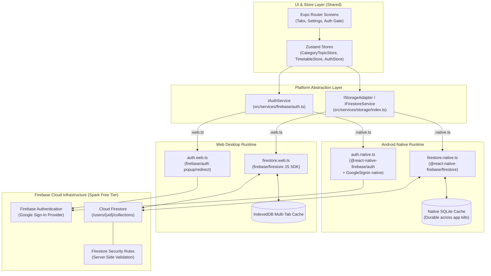
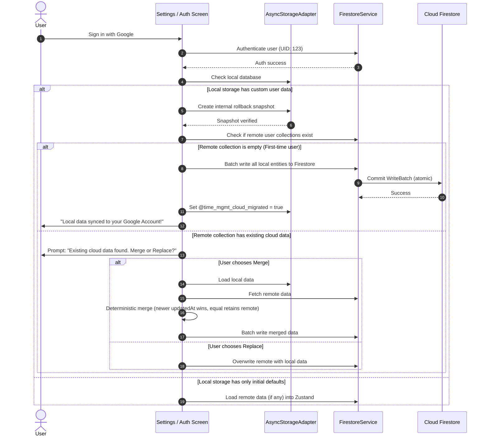
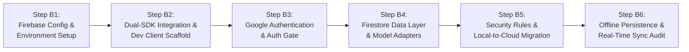

# Milestone B Implementation Plan: Firebase, Google Auth & Cloud Sync

> [!IMPORTANT]
> **Status:** PROPOSED — Awaiting Technical Review by ChatGPT and Approval by User.  
> **Rule:** No application code changes, package installations, or Firebase resource creations will take place until this plan is formally approved.

---

## 1. Executive Summary & Architecture Overview

Milestone B transitions the Time Management application from the hardened Milestone A/B0 local storage (`AsyncStorageAdapter`) to a **cross-platform, real-time synchronized cloud architecture** powered by Firebase, while preserving 100% of existing local features, data integrity, and offline capability.

### Architectural Tenets
1. **Dual-SDK Platform Abstraction:**
   - **Android (Native):** Uses `@react-native-firebase/app`, `@react-native-firebase/auth`, and `@react-native-firebase/firestore`. Backed by native Android SQLite for resilient offline storage that survives app termination and device reboots.
   - **Web (Browser):** Uses modular `firebase/app`, `firebase/auth`, and `firebase/firestore` (JS SDK) configured with `persistentMultipleTabManager()` for robust IndexedDB browser tab persistence.
   - **Unified Service Interface:** The application layer (Zustand stores and UI screens) interacts strictly with a platform-agnostic service interface (`firestore.ts` and `auth.ts`), resolved automatically by Metro via `.native.ts` and `.web.ts` extensions.
2. **Strict User Isolation & Security:**
   - All user data is partitioned under `/users/{uid}/...` subcollections.
   - Server-side Firestore Security Rules validate schema, types, ownership, duration bounds, and write-once actual execution times.
3. **Zero Local Data Loss Guarantee:**
   - First-time sign-in incorporates a verified local-to-cloud migration protocol with pre-migration snapshot verification and deterministic merging (comparing `updatedAt.seconds` and `nanoseconds`).
4. **Strict Cost & Resource Discipline:**
   - Operates entirely within the Firebase Spark (Free) plan and Expo EAS Free Tier (15 cloud builds/month).
   - Queries are bounded to rolling windows (e.g. 7-day timetable window) to eliminate unbounded full-collection scans.

---

## 2. High-Level Architecture Diagram



---

## 3. Detailed Firestore Schema Architecture

To prevent document bloat and ensure granular real-time listeners and indexed queries, the database schema avoids storing monolithic envelopes in single documents. Instead, entities are stored in normalized user-scoped subcollections:

```
users/
└── {uid}/                          (Root document: profile, createdAt, updatedAt)
    ├── settings/
    │   └── userSettings            (Single doc: theme, wakeUpTime, windDownTime, reminder settings)
    ├── categories/
    │   └── {categoryId}            (Category docs: name, priority, sortOrder, color, timestamps)
    ├── topics/
    │   └── {topicId}               (Topic docs: categoryId, name, priority, sortOrder, isActive, timestamps)
    ├── topicTasks/
    │   └── {taskId}                (TopicTask docs: topicId, title, priority, dueDate, isCompleted, notes, timestamps)
    └── timetableBlocks/
        └── {blockId}               (TimetableBlock docs: categoryId, title, date, startTime, durationMin, isFixed, notes, timestamps)
```

### Entity Schema Mapping & Timestamp Compatibility
Milestone A established the domain `AppTimestamp` (`{ seconds: number; nanoseconds: number }`). The Firestore service translates bidirectionally:
- **Writing to Firestore:** Domain `AppTimestamp` is converted to native Firestore `Timestamp` (using `Timestamp.fromMillis()` or `new Timestamp(seconds, nanoseconds)`).
- **Reading from Firestore:** Firestore `Timestamp` is converted back to the serializable domain `AppTimestamp` interface, decoupling UI components and Zustand stores from SDK-specific classes.
- **Forward-Compatible Nullable Placeholders:** `TimetableBlock` documents retain nullable fields (`status`, `actualStart`, `actualEnd`, `actualHistory`) to ensure seamless transition to execution timing and routine generation without future schema migrations.

---

## 4. Server-Side Firestore Security Rules Specification

Firestore Security Rules enforce strict authorization and data validation on every write:

```javascript
rules_version = '2';
service cloud.firestore {
  match /databases/{database}/documents {
    
    // Helper Functions
    function isAuthenticated() {
      return request.auth != null;
    }
    
    function isOwner(uid) {
      return isAuthenticated() && request.auth.uid == uid;
    }
    
    function isValidTimestamp(ts) {
      return ts is timestamp;
    }
    
    function isValidPriority(p) {
      return p in ['high', 'medium', 'low'];
    }

    // Default Deny All
    match /{document=**} {
      allow read, write: if false;
    }

    // User Root Document
    match /users/{uid} {
      allow read, write: if isOwner(uid);
      
      // User Settings Subcollection
      match /settings/userSettings {
        allow read, write: if isOwner(uid);
      }
      
      // Categories Subcollection
      match /categories/{categoryId} {
        allow read: if isOwner(uid);
        allow create, update: if isOwner(uid)
          && request.resource.data.keys().hasOnly(['id', 'name', 'priority', 'sortOrder', 'color', 'createdAt', 'updatedAt'])
          && request.resource.data.id is string && request.resource.data.id.size() > 0
          && request.resource.data.name is string && request.resource.data.name.size() > 0
          && isValidPriority(request.resource.data.priority)
          && request.resource.data.sortOrder is number
          && request.resource.data.color is string
          && isValidTimestamp(request.resource.data.createdAt)
          && isValidTimestamp(request.resource.data.updatedAt);
        allow delete: if isOwner(uid);
      }
      
      // Topics Subcollection
      match /topics/{topicId} {
        allow read: if isOwner(uid);
        allow create, update: if isOwner(uid)
          && request.resource.data.keys().hasOnly(['id', 'categoryId', 'name', 'priority', 'sortOrder', 'isActive', 'createdAt', 'updatedAt'])
          && request.resource.data.id is string
          && request.resource.data.categoryId is string
          && request.resource.data.name is string && request.resource.data.name.size() > 0
          && isValidPriority(request.resource.data.priority)
          && request.resource.data.sortOrder is number
          && request.resource.data.isActive is bool
          && isValidTimestamp(request.resource.data.createdAt)
          && isValidTimestamp(request.resource.data.updatedAt);
        allow delete: if isOwner(uid);
      }
      
      // Topic Tasks Subcollection
      match /topicTasks/{taskId} {
        allow read: if isOwner(uid);
        allow create, update: if isOwner(uid)
          && request.resource.data.keys().hasAll(['id', 'topicId', 'title', 'priority', 'isCompleted', 'createdAt', 'updatedAt'])
          && request.resource.data.title is string && request.resource.data.title.size() > 0
          && isValidPriority(request.resource.data.priority)
          && request.resource.data.isCompleted is bool
          && isValidTimestamp(request.resource.data.createdAt)
          && isValidTimestamp(request.resource.data.updatedAt);
        allow delete: if isOwner(uid);
      }
      
      // Timetable Blocks Subcollection
      match /timetableBlocks/{blockId} {
        allow read: if isOwner(uid);
        allow create, update: if isOwner(uid)
          && request.resource.data.keys().hasAll(['id', 'title', 'categoryId', 'priority', 'date', 'startTime', 'durationMin', 'isFixed', 'createdAt', 'updatedAt'])
          && request.resource.data.title is string && request.resource.data.title.size() > 0
          && request.resource.data.categoryId is string
          && isValidPriority(request.resource.data.priority)
          && request.resource.data.date.matches('^\\d{4}-\\d{2}-\\d{2}$')
          && request.resource.data.startTime.matches('^\\d{2}:\\d{2}$')
          && request.resource.data.durationMin is number && request.resource.data.durationMin >= 5 && request.resource.data.durationMin <= 480
          && request.resource.data.isFixed is bool
          && isValidTimestamp(request.resource.data.createdAt)
          && isValidTimestamp(request.resource.data.updatedAt)
          // Write-once actual execution times protection
          && (!('actualStart' in resource.data) || resource.data.actualStart == null || request.resource.data.actualStart == resource.data.actualStart);
        allow delete: if isOwner(uid);
      }
    }
  }
}
```

---

## 5. Local-to-Cloud Migration Protocol

When a user who has accumulated local data in `AsyncStorage` logs in with Google for the first time, a smooth, lossless transition to Firestore is required:



### Safety Guarantees:
1. **Rollback Snapshot:** Local data in `AsyncStorage` is never deleted upon cloud sync. It is retained as a local offline cache and fallback.
2. **Atomic Batch Writes:** All entities are written to Firestore in atomic `WriteBatch` chunks (max 500 operations per batch per Firestore limits). If any write fails, zero remote records are committed.
3. **Deterministic Conflict Resolution:** If both local and remote have a record with the same ID, timestamps are compared across `seconds` and `nanoseconds`. The newer record wins; equal timestamps retain the cloud record.

---

## 6. Offline Persistence & Multi-Platform Synchronization

### Android (Native SDK)
- `@react-native-firebase/firestore` automatically initializes a native SQLite cache on disk.
- Offline writes are appended to the SQLite mutation queue and immediately surfaced in local snapshot listeners.
- Mutations persist across app termination and device reboots, synchronizing automatically when connectivity resumes.

### Web (Browser SDK)
- Configured using modern modular Firestore cache settings:
  ```typescript
  import { initializeFirestore, persistentLocalCache, persistentMultipleTabManager } from 'firebase/firestore';
  
  const db = initializeFirestore(app, {
    localCache: persistentLocalCache({
      tabManager: persistentMultipleTabManager(),
    }),
  });
  ```
- Ensures multiple tabs share a single IndexedDB synchronization queue without tab lock collisions.
- Provides public workstation warnings in Settings regarding local browser caching.

---

## 7. Cost Controls & Free Tier Guardrails

All features are designed to operate perpetually within the **Firebase Spark (Free) plan**:

| Resource | Spark Free Tier Limit | Expected App Daily Volume | Headroom |
| :--- | :--- | :--- | :--- |
| **Firestore Document Reads** | 50,000 / day | ~150 – 400 reads/day | > 99% free quota remaining |
| **Firestore Document Writes** | 20,000 / day | ~20 – 100 writes/day | > 99% free quota remaining |
| **Firestore Document Deletes** | 20,000 / day | ~5 – 30 deletes/day | > 99% free quota remaining |
| **Firestore Stored Data** | 1 GiB total | < 5 MB for text/routine data | > 99% free quota remaining |
| **Firebase Auth MAUs** | 50,000 / month | 1 user | 100% free |
| **EAS Android Cloud Builds** | 15 / month | ~2 – 4 dev builds total | Within quota (Local builds unlimited) |

### Optimization Rules
1. **Bounded Date Queries:** Queries for timetable blocks always include `.where('date', '>=', startDate).where('date', '<=', endDate)` matching the active 7-day rolling window.
2. **Active-Only Filtering:** Topic queries filter on `.where('isActive', '==', true)` on the dashboard.
3. **No Unbounded Listeners:** Real-time listeners unsubscribe immediately on component unmount (`useEffect` return cleanup).
4. **Billing Budget Alert:** Guidance to configure a $5/month billing budget alert in the Google Cloud Console to prevent unexpected charges.

---

## 8. Phased Implementation Roadmap (Small, Independently Reviewable Steps)

Milestone B is partitioned into 6 distinct, reviewable phases. Each phase has specific entry/exit criteria and verification tests:



### Step B1: Firebase Cloud Project & Environment Setup
- **Work:** 
  - Register Firebase project on Spark plan.
  - Register Android application (`package: com.timemanagementapp`).
  - Configure SHA-1 / SHA-256 fingerprint for Google OAuth in Google Cloud Console.
  - Download and gitignore `google-services.json`.
  - Create web application credentials in Firebase Console.
  - Set up environment variables via `.env.example` and gitignored `.env`.
- **Review Deliverables:** Sanitized configuration verification, `.gitignore` audit (no API secrets or keystores committed).
- **Test Gate:** Validation script asserts presence of required configuration keys.

### Step B2: Dual-SDK Abstraction & Dependency Installation
- **Work:**
  - Install Expo SDK 58 compatible versions:
    - `@react-native-firebase/app`, `@react-native-firebase/auth`, `@react-native-firebase/firestore`
    - `@react-native-google-signin/google-signin`
    - `firebase` (modular JS v10/v11 for Web)
    - `expo-dev-client`
  - Implement abstraction stubs:
    - `src/services/firebase/app.native.ts` vs `app.web.ts`
    - `src/services/firebase/auth.native.ts` vs `auth.web.ts`
    - `src/services/firebase/firestore.native.ts` vs `firestore.web.ts`
- **Review Deliverables:** Package resolution report and Metro platform bundling check.
- **Test Gate:** `npm test`, `npm run typecheck`, and `npx expo export --platform web`.

### Step B3: Google Authentication & Auth Gate Navigation
- **Work:**
  - Implement native Google Sign-in flow on Android and popup flow on Web.
  - Implement `useAuthStore` (user profile, auth status, session persistence).
  - Implement `app/(auth)/sign-in.tsx` and auth gate in `app/_layout.tsx`.
  - Add User Profile & Sign-Out button to `app/(tabs)/settings.tsx`.
- **Review Deliverables:** Auth state machine, sign-in UI, error handling for user cancellation and network failures.
- **Test Gate:** Automated unit tests for `useAuthStore` (login, logout, session restoration, error states).

### Step B4: Firestore Data Layer & Domain Model Adapters
- **Work:**
  - Implement `FirestoreStorageAdapter implements IStorageAdapter`.
  - Add bidirectional `AppTimestamp` $\leftrightarrow$ Firestore `Timestamp` converters.
  - Implement CRUD and batch methods for Categories, Topics, TopicTasks, and TimetableBlocks.
  - Integrate atomic batch operations for category cascade deletion and dependency moving.
- **Review Deliverables:** Code review of data service methods, batch chunking (max 500), and converter helpers.
- **Test Gate:** Unit tests for model mapping, timestamp conversions, and batch operation logic.

### Step B5: Server-Side Security Rules & Local-to-Cloud Migration
- **Work:**
  - Author and deploy `firestore.rules` (user isolation, whitelist keys, type checks, write-once actual times).
  - Implement the Local-to-Cloud Migration engine with pre-migration snapshot verification and merge prompts.
  - Add migration status indicators to Settings.
- **Review Deliverables:** Security rules syntax audit and migration workflow walkthrough.
- **Test Gate:** Security rules unit test suite simulating allowed/denied paths; migration unit tests simulating clean cloud sync and conflict merging.

### Step B6: Offline Persistence & Real-Time Sync Audit
- **Work:**
  - Enable native SQLite persistence on Android and IndexedDB multi-tab persistence on Web.
  - Connect real-time snapshot listeners (`onSnapshot`) to Zustand stores with optimistic local updates.
  - Add Network Sync Status indicator to the dashboard header.
  - Verify 7-day rolling window query constraints.
- **Review Deliverables:** Final sync audit report, offline test checklist, and performance review.
- **Test Gate:** Full automated test suite passing; manual offline flight-mode tests; `npm test`, `npm run typecheck`, and `expo export --platform web`.

---

## 9. Dependencies, Risks & Required User Decisions

### Required Dependencies (SDK 58 Target)
- `@react-native-firebase/app`: ~21.x / ~22.x compatible with React Native 0.79 / Expo SDK 58
- `@react-native-firebase/auth`: matching version
- `@react-native-firebase/firestore`: matching version
- `@react-native-google-signin/google-signin`: ~13.x
- `firebase`: ~10.14.x / ~11.x
- `expo-dev-client`: ~5.0.x

### Key Risks & Mitigations
| Risk | Severity | Mitigation Strategy |
| :--- | :--- | :--- |
| **EAS Free Tier Build Limit (15/mo)** | Medium | Use hot-reload during development. Only build native binaries when native dependencies change. Use `eas build --local` as an unlimited alternative. |
| **Accidental Overwrite of Local Data** | High | Mandatory verified local rollback snapshot before initiating cloud migration. Local AsyncStorage data is never purged. |
| **Web Multi-Tab Firestore Write Conflicts** | Low | Configured `persistentMultipleTabManager()` on web IndexedDB cache. |
| **Firestore Spark Free Tier Exceeded** | Low | Query constraints enforce 7-day bounds; listeners clean up on unmount; billing budget alerts set up at $5/month. |

### Required User Decisions Prior to Step B1 Implementation
1. **Google Account & Firebase Project Setup:** Will the user create the Firebase project directly in the Firebase Console and supply the config, or should Antigravity guide the exact console clicks?
2. **First-Time Migration Default:** When local data is detected upon Google Sign-In, should the app automatically upload it if the cloud is empty, or prompt with an explicit confirmation dialog? *(Recommended: Prompt with clear explanation)*.
3. **Build Target:** Will early native Android testing use EAS Cloud builds or local development builds?

---

## 10. Summary & Next Steps

This plan provides a structured, safe, and verifiable roadmap for Milestone B. 

**Next Action:** Await technical review by ChatGPT and explicit approval from the User before initiating Step B1. No code or configuration changes will be made until approval is granted.
