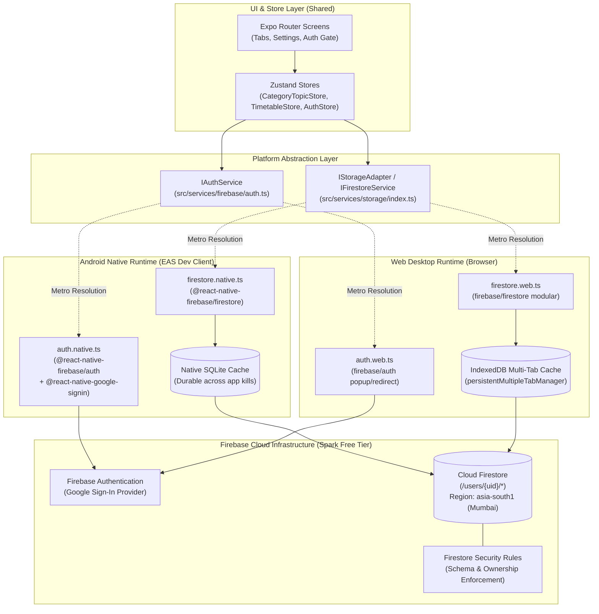
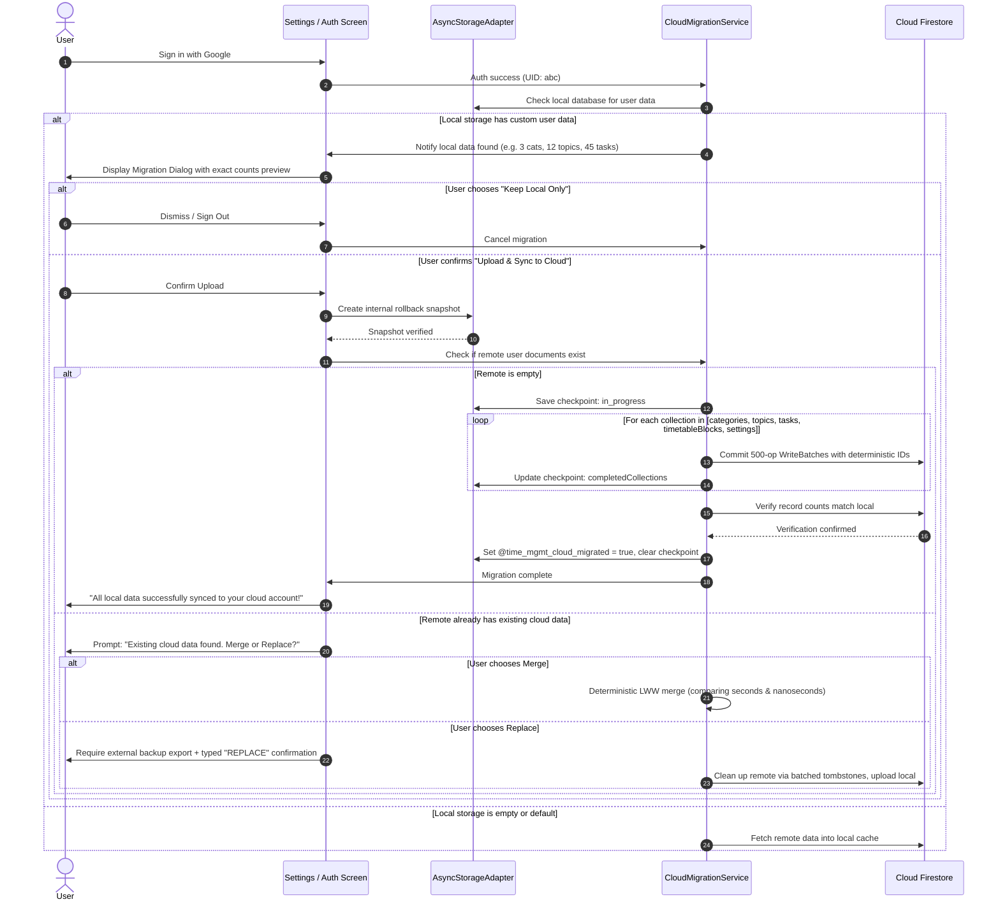

# Milestone B Implementation Plan: Firebase, Google Auth & Cloud Sync

> [!IMPORTANT]
> **Status:** PROPOSED (Revised with Technical Review Feedback) — Awaiting Approval by ChatGPT and User.  
> **Strict Rule:** No application code changes, package installations, or Firebase cloud resource creations will take place until this plan is formally approved. Step B0 deferred validation issue (REV-018) remains documented.

---

## 1. Executive Summary & Architecture Overview

Milestone B transitions the Time Management application from the hardened Milestone A/B0 local storage (`AsyncStorageAdapter`) to a **cross-platform, real-time synchronized cloud architecture** powered by Firebase, while preserving 100% of existing local features, data integrity, and offline capability.

### Architectural Tenets
1. **Dual-SDK Platform Abstraction:**
   - **Android (Native):** Uses `@react-native-firebase/app`, `@react-native-firebase/auth`, and `@react-native-firebase/firestore`. Backed by native Android SQLite for resilient offline storage that survives app termination and device reboots.
   - **Web (Browser):** Uses modular `firebase/app`, `firebase/auth`, and `firebase/firestore` (JS SDK v11) configured with `persistentMultipleTabManager()` for robust IndexedDB browser tab persistence.
   - **Unified Service Interface:** The application layer (Zustand stores and UI screens) interacts strictly with a platform-agnostic service interface (`firestore.ts` and `auth.ts`), resolved automatically by Metro via `.native.ts` and `.web.ts` extensions.
2. **Strict User Isolation & Granular Security:**
   - All user data is partitioned under `/users/{uid}/...` subcollections.
   - Server-side Firestore Security Rules validate schema, types, ownership, duration bounds, foreign keys, and write-once actual execution times using both `hasAll` and `hasOnly`.
3. **Zero Local Data Loss & Resumable Migration:**
   - First-time sign-in incorporates an explicit, opt-in migration protocol with record counts preview, internal rollback snapshot, deterministic document IDs, and local checkpointing (`@time_mgmt_migration_checkpoint`). Local data in `AsyncStorage` is never deleted.
4. **Strict Cost & Resource Discipline:**
   - Operates entirely within the Firebase Spark (Free) plan ($0/mo) and Expo EAS Free Tier (15 cloud builds/month).
   - Queries are bounded to rolling windows (e.g. 7-day timetable window) with pagination to eliminate unbounded full-collection scans.
   - Budget alerts configured in Google Cloud Console as notifications (noting that alerts do not hard-cap spend).

---

## 2. High-Level Architecture Diagram



---

## 3. Data Architecture & Firestore Schema

### Collection Hierarchy
All data belongs strictly to individual authenticated users. No global top-level collections containing multi-tenant user data are permitted:

```text
/users/{uid}                                (User root document: profile, schemaVersion, timestamps)
    ├── settings/
    │   └── userSettings                    (Preferences doc: theme, timeFormat, defaultBlockDurationMin, schemaVersion)
    ├── categories/
    │   └── {categoryId}                    (Category docs: name, priority, sortOrder, color, isDeleted, timestamps)
    ├── topics/
    │   └── {topicId}                       (Topic docs: categoryId, name, priority, sortOrder, color, isDeleted, timestamps)
    ├── tasks/
    │   └── {taskId}                        (Task docs: topicId, title, description, priority, isCompleted, isDeleted, timestamps)
    └── timetableBlocks/
        └── {blockId}                       (TimetableBlock docs: categoryId, title, date, startTime, durationMin, isFixed, status, actualStart, actualEnd, actualHistory, isDeleted, timestamps)
```

### Entity Schema Mapping & Timestamp Compatibility
Milestone A established the domain `AppTimestamp` (`{ seconds: number; nanoseconds: number }`). The Firestore service translates bidirectionally:
- **Writing to Firestore:** Domain `AppTimestamp` is converted to native Firestore `Timestamp` (`Timestamp.fromMillis()` or `new Timestamp(seconds, nanoseconds)`).
- **Reading from Firestore:** Firestore `Timestamp` is converted back to the serializable domain `AppTimestamp` interface, decoupling UI components and Zustand stores from SDK-specific classes.
- **Nanosecond-Aware Precision:** Timestamps retain full sub-second precision (`nanoseconds`) during conflict comparisons to prevent clock collision during rapid updates.
- **Forward-Compatible Execution Placeholders:** `TimetableBlock` documents retain fields (`status`, `actualStart`, `actualEnd`, `actualHistory`) to ensure a seamless transition to execution timing and routine generation without schema rewrites.
- **Soft Deletion Fields:** All entity collections support `isDeleted: bool` (optional/default false) and `deletedAt: timestamp` (nullable) to allow offline clients to detect and reconcile deletions reliably.

---

## 4. Server-Side Firestore Security Rules Specification

Firestore Security Rules enforce strict authorization, schema conformance, foreign key referential integrity, and mutation constraints on every write:

```javascript
rules_version = '2';
service cloud.firestore {
  match /databases/{database}/documents {
    
    // Helper Functions
    function isAuthenticated() {
      return request.auth != null;
    }
    
    function isOwner(uid) {
      return isAuthenticated() && request.auth.uid == uid;
    }
    
    function isValidTimestamp(ts) {
      return ts is timestamp;
    }
    
    function isValidPriority(p) {
      return p in ['high', 'medium', 'low'];
    }

    function isValidBlockStatus(s) {
      return s in ['planned', 'in_progress', 'completed', 'cancelled'];
    }

    // Default Deny All
    match /{document=**} {
      allow read, write: if false;
    }

    // User Root Document
    match /users/{uid} {
      allow read: if isOwner(uid);
      allow create, update: if isOwner(uid)
        && request.resource.data.keys().hasAll(['uid', 'schemaVersion', 'createdAt', 'updatedAt'])
        && request.resource.data.keys().hasOnly(['uid', 'email', 'displayName', 'photoURL', 'schemaVersion', 'createdAt', 'updatedAt'])
        && request.resource.data.uid == uid
        && request.resource.data.schemaVersion is number && request.resource.data.schemaVersion >= 2
        && isValidTimestamp(request.resource.data.createdAt)
        && isValidTimestamp(request.resource.data.updatedAt);
      allow delete: if false; // User document cannot be deleted directly from client

      // User Settings Subcollection
      match /settings/userSettings {
        allow read: if isOwner(uid);
        allow create, update: if isOwner(uid)
          && request.resource.data.keys().hasAll(['theme', 'timeFormat', 'defaultBlockDurationMin', 'schemaVersion', 'updatedAt'])
          && request.resource.data.keys().hasOnly(['theme', 'timeFormat', 'defaultBlockDurationMin', 'schemaVersion', 'updatedAt'])
          && request.resource.data.theme in ['system', 'light', 'dark']
          && request.resource.data.timeFormat in ['12h', '24h']
          && request.resource.data.defaultBlockDurationMin is number 
          && request.resource.data.defaultBlockDurationMin >= 5 && request.resource.data.defaultBlockDurationMin <= 240
          && request.resource.data.schemaVersion is number && request.resource.data.schemaVersion >= 2
          && isValidTimestamp(request.resource.data.updatedAt);
        allow delete: if false;
      }
      
      // Categories Subcollection
      match /categories/{categoryId} {
        allow read: if isOwner(uid);
        allow create, update: if isOwner(uid)
          && request.resource.data.id == categoryId
          && request.resource.data.keys().hasAll(['id', 'name', 'priority', 'sortOrder', 'color', 'createdAt', 'updatedAt'])
          && request.resource.data.keys().hasOnly(['id', 'name', 'priority', 'sortOrder', 'color', 'isDeleted', 'deletedAt', 'createdAt', 'updatedAt'])
          && request.resource.data.id is string && request.resource.data.id.size() > 0 && request.resource.data.id.size() <= 64
          && request.resource.data.name is string && request.resource.data.name.size() > 0 && request.resource.data.name.size() <= 100
          && isValidPriority(request.resource.data.priority)
          && request.resource.data.sortOrder is number
          && request.resource.data.color.matches('^#[0-9A-Fa-f]{6}$')
          && (!('isDeleted' in request.resource.data) || request.resource.data.isDeleted is bool)
          && (!('deletedAt' in request.resource.data) || request.resource.data.deletedAt == null || isValidTimestamp(request.resource.data.deletedAt))
          && isValidTimestamp(request.resource.data.createdAt)
          && isValidTimestamp(request.resource.data.updatedAt);
        allow delete: if isOwner(uid);
      }
      
      // Topics Subcollection
      match /topics/{topicId} {
        allow read: if isOwner(uid);
        allow create, update: if isOwner(uid)
          && request.resource.data.id == topicId
          && request.resource.data.keys().hasAll(['id', 'categoryId', 'name', 'priority', 'sortOrder', 'color', 'createdAt', 'updatedAt'])
          && request.resource.data.keys().hasOnly(['id', 'categoryId', 'name', 'priority', 'sortOrder', 'color', 'isDeleted', 'deletedAt', 'createdAt', 'updatedAt'])
          && request.resource.data.id is string && request.resource.data.id.size() > 0 && request.resource.data.id.size() <= 64
          // Foreign Key Validation: Category must exist under user
          && exists(/databases/$(database)/documents/users/$(uid)/categories/$(request.resource.data.categoryId))
          && request.resource.data.name is string && request.resource.data.name.size() > 0 && request.resource.data.name.size() <= 100
          && isValidPriority(request.resource.data.priority)
          && request.resource.data.sortOrder is number
          && request.resource.data.color.matches('^#[0-9A-Fa-f]{6}$')
          && (!('isDeleted' in request.resource.data) || request.resource.data.isDeleted is bool)
          && (!('deletedAt' in request.resource.data) || request.resource.data.deletedAt == null || isValidTimestamp(request.resource.data.deletedAt))
          && isValidTimestamp(request.resource.data.createdAt)
          && isValidTimestamp(request.resource.data.updatedAt);
        allow delete: if isOwner(uid);
      }
      
      // Tasks Subcollection
      match /tasks/{taskId} {
        allow read: if isOwner(uid);
        allow create, update: if isOwner(uid)
          && request.resource.data.id == taskId
          && request.resource.data.keys().hasAll(['id', 'topicId', 'title', 'priority', 'isCompleted', 'createdAt', 'updatedAt'])
          && request.resource.data.keys().hasOnly(['id', 'topicId', 'title', 'description', 'priority', 'isCompleted', 'isDeleted', 'deletedAt', 'createdAt', 'updatedAt'])
          && request.resource.data.id is string && request.resource.data.id.size() > 0 && request.resource.data.id.size() <= 64
          // Foreign Key Validation: Topic must exist under user
          && exists(/databases/$(database)/documents/users/$(uid)/topics/$(request.resource.data.topicId))
          && request.resource.data.title is string && request.resource.data.title.size() > 0 && request.resource.data.title.size() <= 200
          && (!('description' in request.resource.data) || (request.resource.data.description is string && request.resource.data.description.size() <= 1000))
          && isValidPriority(request.resource.data.priority)
          && request.resource.data.isCompleted is bool
          && (!('isDeleted' in request.resource.data) || request.resource.data.isDeleted is bool)
          && (!('deletedAt' in request.resource.data) || request.resource.data.deletedAt == null || isValidTimestamp(request.resource.data.deletedAt))
          && isValidTimestamp(request.resource.data.createdAt)
          && isValidTimestamp(request.resource.data.updatedAt);
        allow delete: if isOwner(uid);
      }
      
      // TimetableBlocks Subcollection
      match /timetableBlocks/{blockId} {
        allow read: if isOwner(uid);
        allow create, update: if isOwner(uid)
          && request.resource.data.id == blockId
          && request.resource.data.keys().hasAll(['id', 'title', 'categoryId', 'priority', 'date', 'startTime', 'durationMin', 'isFixed', 'createdAt', 'updatedAt'])
          && request.resource.data.keys().hasOnly(['id', 'title', 'categoryId', 'priority', 'date', 'startTime', 'durationMin', 'isFixed', 'notes', 'status', 'actualStart', 'actualEnd', 'actualHistory', 'isDeleted', 'deletedAt', 'createdAt', 'updatedAt'])
          && request.resource.data.id is string && request.resource.data.id.size() > 0 && request.resource.data.id.size() <= 64
          // Foreign Key Validation: Category must exist under user
          && exists(/databases/$(database)/documents/users/$(uid)/categories/$(request.resource.data.categoryId))
          && request.resource.data.title is string && request.resource.data.title.size() > 0 && request.resource.data.title.size() <= 200
          && isValidPriority(request.resource.data.priority)
          && request.resource.data.date.matches('^\\d{4}-\\d{2}-\\d{2}$')
          && request.resource.data.startTime.matches('^\\d{2}:\\d{2}$')
          && request.resource.data.durationMin is number && request.resource.data.durationMin >= 5 && request.resource.data.durationMin <= 480
          && request.resource.data.isFixed is bool
          && (!('notes' in request.resource.data) || (request.resource.data.notes is string && request.resource.data.notes.size() <= 1000))
          && (!('status' in request.resource.data) || isValidBlockStatus(request.resource.data.status))
          && (!('isDeleted' in request.resource.data) || request.resource.data.isDeleted is bool)
          && (!('deletedAt' in request.resource.data) || request.resource.data.deletedAt == null || isValidTimestamp(request.resource.data.deletedAt))
          && isValidTimestamp(request.resource.data.createdAt)
          && isValidTimestamp(request.resource.data.updatedAt)
          // Write-once actual execution times protection (cannot mutate once set)
          && (!('actualStart' in resource.data) || resource.data.actualStart == null || request.resource.data.actualStart == resource.data.actualStart)
          && (!('actualEnd' in resource.data) || resource.data.actualEnd == null || request.resource.data.actualEnd == resource.data.actualEnd)
          // Append-only history protection
          && (!('actualHistory' in resource.data) || resource.data.actualHistory == null || (request.resource.data.actualHistory is list && request.resource.data.actualHistory.size() >= resource.data.actualHistory.size()));
        allow delete: if isOwner(uid);
      }
    }
  }
}
```

---

## 5. Local-to-Cloud Migration Protocol

### Resumable Migration & Batch Independence
Firestore batches (`WriteBatch`) support a maximum of 500 operations and each commit is an **independent network transaction**. Multiple batches do NOT form a single global atomic commit across the entire database.

To guarantee zero data loss and flawless recovery from network drops or partial failures, the migration protocol implements:
1. **Deterministic Document IDs:** Document IDs in Firestore match local IDs exactly (`/users/{uid}/{collection}/{id}`). Writing the same document multiple times is completely idempotent.
2. **Local Progress Checkpointing:** Migration state is tracked locally in `@time_mgmt_migration_checkpoint`:
   ```typescript
   interface MigrationCheckpoint {
     uid: string;
     status: 'in_progress' | 'completed' | 'failed';
     completedCollections: ('categories' | 'topics' | 'tasks' | 'timetableBlocks' | 'settings')[];
     lastProcessedId: string | null;
     totalUploaded: number;
     startedAt: string;
     updatedAt: string;
   }
   ```
3. **Sequential Dependency Upload:** Categories are uploaded first, followed by Topics, Tasks, and TimetableBlocks, ensuring foreign keys pass Firestore Security Rules `exists()` checks.
4. **Post-Migration Verification:** After all batches commit, the migration service queries count aggregates (`getCountFromServer()`) or checks document presence before flagging the migration as completed.
5. **Permanent Local Data Preservation:** Local `AsyncStorage` data is **never purged**. It remains intact as a local offline cache and permanent disaster-recovery backup.



---

## 6. Conflict Resolution & Offline Strategy

### Last-Write-Wins (LWW) with Nanosecond Precision
1. **Timestamp Comparison:** Whenever a conflict occurs between a local offline modification and an incoming remote snapshot, `updatedAt` is compared:
   ```typescript
   function resolveConflict<T extends { updatedAt: AppTimestamp }>(local: T, remote: T): T {
     if (remote.updatedAt.seconds > local.updatedAt.seconds) return remote;
     if (remote.updatedAt.seconds < local.updatedAt.seconds) return local;
     return remote.updatedAt.nanoseconds >= local.updatedAt.nanoseconds ? remote : local;
   }
   ```
2. **Field-Level Updates:** Status changes (e.g., toggling task `isCompleted` or timetable `status`) issue field-level updates (`updateDoc`) rather than full document overwrites, allowing non-conflicting concurrent edits to merge cleanly.
3. **Soft-Delete Propagation & Tombstones:** Deleted entities mark `isDeleted: true` and record `deletedAt`. Snapshot listeners filter out records with `isDeleted === true`, preventing re-emergence of locally deleted records during reconnection.
4. **Orphan Preservation ("Needs Attention"):** If a parent Category or Topic is deleted remotely while child records were modified locally offline, child records are not silently dropped. They are reassigned to an unassigned category or marked with an `isOrphan: true` badge in a "Needs Attention" UI view.

---

## 7. Replace-All Safeguards & Cloud Cleanup

Milestone A/B0 established rigorous Replace-All safeguards (REV-014 / Decision 016). In Milestone B, these are extended to cloud operations:
1. **External Backup Verification Required:** Replace-All cannot be initiated unless an external backup has been successfully exported via native share or file download.
2. **Internal Rollback Snapshot:** An automated internal snapshot of the current local state is created before any replacement begins.
3. **Record Count Preview & Typed Confirmation:** The user is presented with a side-by-side comparison of current vs replacement counts and must type `"REPLACE"` to confirm.
4. **Cloud Cleanup via Batched Deletion:** The migration service executes batched soft-deletes or document deletions across remote subcollections in batches of 500 before writing the new dataset, preventing orphaned remnants from polluting the new state.

---

## 8. Firebase Setup, Cost Controls & Configuration

### Firestore Database Location
- **Recommended Candidate Region:** `asia-south1` (Mumbai) for ultra-low latency in India, or `nam5` / `eur3` multi-region if global redundancy is preferred.
- **Irreversibility Notice:** Database location is permanent once created and cannot be altered. The user must confirm region selection during project initialization.

### Strict Spark Plan Budget Controls
- **Default Plan:** Firebase Spark (Free Tier) with $0/month budget. No upgrade to Blaze plan will be initiated without explicit user approval.
- **Google Cloud Budget Alerts:** Budget alerts configured at $1 and $5 thresholds in Google Cloud Console. Note: Alerts deliver automated emails; they do not automatically terminate services or hard-cap usage.
- **Cost Discipline Enforcements:**
  - Rolling 7-day query window for timetable blocks (`where('date', '>=', startDate).where('date', '<=', endDate)`).
  - Snapshot listeners attached only to active screens and detached on unmount.
  - Zero full-collection unbounded queries.

### Client Configuration vs Private Secrets
- **Client Configuration:** `google-services.json` (Android) and `firebaseConfig` object (Web) contain client-side identifiers (API Key, Project ID, App ID). These identify the client to Firebase and are safe for client bundling protected by Firestore Security Rules.
- **Private Secrets:** Private service-account private keys are **never** bundled into the client application.
- **Git Hygiene:** `google-services.json` is added to `.gitignore` to prevent credential exposure in public repositories. A template `google-services.json.example` is checked into source control.

### Expo & Google OAuth Configuration
- **Android Package Identifier:** `com.melvin.timemanagementapp` (strictly matching `app.json`).
- **EAS Development Build Requirement:** Native Google Sign-In and `@react-native-firebase` require native modules and cannot run inside standard Expo Go. Testing must use EAS Development Builds (`npx expo run:android` or `eas build --profile development`).
- **SHA-1 Fingerprints:** Both local debug keystore SHA-1 (`keytool -list -v -keystore ~/.android/debug.keystore`) and EAS cloud keystore SHA-1 must be registered under the Android App in Firebase Console.
- **Web OAuth Redirect Domains:** `localhost`, `127.0.0.1`, and production hosting domains must be registered under Firebase Auth > Settings > Authorized Domains.
- **Expo Config Plugins:** `app.json` includes `@react-native-firebase/app` in the `plugins` array.

---

## 9. Dependency Specification & Compatibility Matrix

> [!WARNING]
> **DO NOT INSTALL YET.** Packages will be installed in Step B1 only after full plan approval.

| Package | Target Version | Compatibility Notes |
| :--- | :--- | :--- |
| `expo` | `~58.0.0` (installed) | Core SDK |
| `react-native` | `0.88.1` (installed) | New Architecture enabled |
| `expo-dev-client` | `~58.0.x` | Matches Expo SDK 58 (replaces older `~5.0.x`) |
| `@react-native-firebase/app` | `^21.x` / `^22.x` | Native Android Firebase module (supports RN 0.88) |
| `@react-native-firebase/auth` | `^21.x` / `^22.x` | Native Android Authentication |
| `@react-native-firebase/firestore` | `^21.x` / `^22.x` | Native Android Firestore with SQLite persistence |
| `@react-native-google-signin/google-signin` | `^13.x` | Native Android Google Play Services Sign-In |
| `firebase` | `^11.x` | Web modular JS SDK (Auth + Firestore IndexedDB) |

---

## 10. Step-by-Step Implementation Roadmap


### Step B1: Dependency Installation & Native Build Configuration
- Install verified SDK 58 dependencies.
- Update `app.json` with `@react-native-firebase/app` plugin, package name `com.melvin.timemanagementapp`, and `googleServicesFile`.
- Add `google-services.json` to `.gitignore` and create `google-services.json.example`.
- Build EAS Android development client (`npx expo run:android` or `eas build --profile development`).
- **Test Gate:** Dev client builds cleanly; web exports cleanly (`npx expo export --platform web`).

### Step B2: Firebase Project Setup, Security Rules & Emulator Testing
- Initialize Firebase project with region `asia-south1` (or user choice).
- Set up Firebase Emulator suite locally for Firestore and Auth.
- Write unit tests for Security Rules using `@firebase/rules-unit-testing`:
  - Verify rejection of unauthenticated reads/writes.
  - Verify schema validation (mandatory `hasAll` and permitted `hasOnly`).
  - Verify docId == payload id check.
  - Verify foreign key checks via `exists()`.
  - Verify write-once protection for `actualStart` and `actualEnd`.
  - Verify append-only protection for `actualHistory`.
- **Test Gate:** 100% of Firebase Security Rules emulator tests pass.

### Step B3: Authentication Service & Auth Gate UI
- Implement `IAuthService` interface with `auth.native.ts` (GoogleSignin) and `auth.web.ts` (Firebase Auth popup).
- Build `AuthGate` component and update Settings screen with Account / Sign-In status.
- Implement token refresh and automatic session restoration.
- **Test Gate:** Google Sign-In succeeds on Android dev build and Web desktop; session restores across restarts.

### Step B4: Firestore Service Abstraction Layer
- Implement `IFirestoreService` interface with `firestore.native.ts` and `firestore.web.ts`.
- Implement bidirectional converters between `AppTimestamp` and Firestore `Timestamp`.
- Implement 7-day rolling window query constraints and pagination.
- **Test Gate:** CRUD operations succeed against Firebase Emulator; domain timestamps match exactly.

### Step B5: Resumable Local-to-Cloud Migration
- Implement `CloudMigrationService` with deterministic doc IDs and `@time_mgmt_migration_checkpoint`.
- Build Migration Confirmation Dialog with exact record counts preview.
- Implement Replace-All cloud cleanup with batched soft-deletes and typed `"REPLACE"` safeguard.
- Write automated tests simulating batch failures, network interruptions, and resumption.
- **Test Gate:** Interrupted migration resumes cleanly without duplicate records; local AsyncStorage remains untouched.

### Step B6: Real-Time Sync, Offline Persistence & Conflict Resolution
- Connect `onSnapshot` listeners to Zustand stores with optimistic UI updates.
- Implement LWW resolver comparing `seconds` and `nanoseconds`.
- Implement soft-delete reconciliation and "Needs Attention" orphan handling.
- Add Network Sync Status indicator to dashboard header.
- **Test Gate:** Automated offline simulation tests pass; manual flight-mode toggle verifies flawless sync reconciliation.

---

## 11. Testing Gates & Verification Matrix

| Step | Automated Test Suite | Manual Verification Gate |
| :--- | :--- | :--- |
| **B1** | `npm test`, `npm run typecheck`, `npx expo export --platform web` | EAS development build boots on Android device |
| **B2** | `@firebase/rules-unit-testing` emulator suite covering all rule branches | Security rules deployed to Firebase Console |
| **B3** | Auth store unit tests with mock providers | Interactive Google Sign-In & Sign-Out on Android & Web |
| **B4** | Firestore adapter CRUD tests against Emulator | Data inspected in Firebase Emulator UI |
| **B5** | Checkpoint serialization, retry idempotency, and partial-batch recovery tests | Full local dataset migrated with count confirmation dialog |
| **B6** | Timestamp conflict resolution and orphan preservation unit tests | Android airplane mode test: edit offline -> reconnect -> verify sync |

---

## 12. Summary & Next Steps

This revised plan addresses all 10 architectural and security findings raised during technical review. 

**Next Action:** Await final review by ChatGPT and explicit approval from the User before initiating Step B1. No code or configuration changes will be made until approval is granted.
